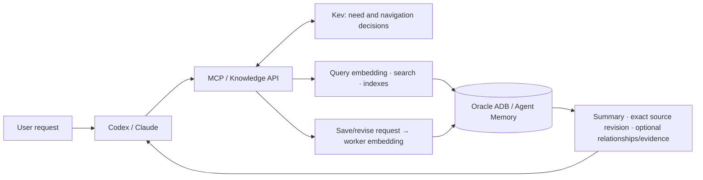

# adb-agent-knowledge

**An open-source knowledge service that uses Oracle Autonomous AI Database to help AI agents retrieve previous knowledge and work context with evidence.**

English · [한국어](README.md) · [Alpha release](docs/releases/v0.3.0-alpha.1.md) · [Documentation](docs/en/README.md)

Connect Codex or Claude through MCP (Model Context Protocol) to store and retrieve project decisions,
solutions and business documents. Korean-capable vector search finds related content even when wording changes;
indexes and graphs lead to connected knowledge and its source evidence. The project is also a practical example
of combining Oracle relational data, vectors, RDF, SQL Property Graph and Agent Memory.

**Current version: `v0.3.0-alpha.1`.** This alpha is for evaluation and feedback in personal/development environments.
Oracle ADB is required; adapters for other production databases are not provided. Docker is optional.
Read the [validation scope and remaining work](docs/releases/v0.3.0-alpha.1.md).

## What problem does it solve?

An agent may lose earlier decisions or solutions from another project when a conversation changes.
This service keeps that information outside the conversation and retrieves it when it can help the next task.

For example, ask **“How did we deploy this project last time?”** The agent can find a deployment note,
read the exact source revision behind its summary and, if relationships have been recorded, inspect the services,
environments and projects connected to it. Corrections create new knowledge revisions while preserving old records.

| Situation | What this helps improve | Mechanism |
|---|---|---|
| You cannot remember the original wording | Find related decisions with different words | Vector + keyword retrieval |
| Work spans sessions or machines | Reuse one knowledge store as the same authenticated user | Remote API/MCP, ownership and project scopes |
| There are too many documents to read fully | Move from summaries to relevant detail and evidence | Indexes, source locations, relationship paths |
| An agent repeats outdated advice | Check memory before answering and deliver approved principles | Client hooks + Kev |
| Content changes or needs justification | Inspect previous revisions and supporting sources | Version history, audit records and evidence links |

The aim is to reduce repeated explanations and unnecessary full-document reading. Token use, latency and answer
accuracy are not guaranteed to improve on every request. Results depend on the stored data and retrieval quality.
Organization-wide sharing controls and automated business-condition evaluation are not complete features.

## Which technologies do what?

| Component | Responsibility | Execution / setup |
|---|---|---|
| Codex / Claude | Tool calls, source review, new-vs-revise decisions, default relationship extraction and answers | Your agent client |
| MCP + Python API/workers | Authentication, ingestion/search, asynchronous indexing and evidence/version checks | Local machine or remote server |
| **Kev** (`jaredpalmer/kev-4b`) | Scores lookup/capture need and direct/index/graph navigation choices | Separate local or remote decision service |
| **Korean embeddings** (`dragonkue/snowflake-arctic-embed-l-v2.0-ko`) | Converts source chunks and queries into 1024-dimensional vectors | API/worker hosts by default; remote provider supported |
| **Oracle Autonomous AI Database** | Compares vectors and stores ownership, knowledge, revisions, audit and relationships | Your ADB instance |
| **Oracle AI Agent Memory** | v3 source/chunk/vector storage; separate agent experience memories | Storage in ADB, accessed through a Python library; initialize separately |
| **RDF / SQL Property Graph** | RDF represents and validates relationships/evidence; Property Graph traverses relational graph data | Optional database setup |
| Notes web UI | Browse knowledge, memories and relationships; manage approved principles | API route `/knowledge` |

**Embedding models do not run inside Oracle.** API/workers compute embeddings or obtain them from a remote
provider, then send vectors to Oracle for storage and comparison. Hosting these processes remotely keeps models
off the agent user's laptop. Retrieval combines vectors with substring keyword candidates, not Oracle Text/BM25.

Default `GRAPH_EXTRACTION_MODE=agent` uses the Codex/Claude model you already run for relationship extraction.
Only optional unattended `service` mode calls a separate generative model endpoint. Kev does not create embeddings,
write answers or verify facts; its scores are not probabilities that a stored claim is true.

[Model settings and execution boundaries](docs/en/architecture-and-models.md) · [v3 storage and search](docs/guides/v3-primary-store.en.md) · [Custom tables vs Agent Memory: speed, embeddings and operations](docs/guides/storage-backends.en.md) · [Oracle graph examples](docs/en/oracle-graph-examples.md)

## How do storage and retrieval work?



- **Retrieve:** assess memory need → search or browse indexes → expand relationships when useful → inspect exact sources/evidence → answer or work.
- **Store:** check value and similar items → inspect originals/history → choose a new item or revision → worker indexes it → confirm `READY`. Similarity alone does not merge documents.
- **Keep purposes distinct:** business knowledge holds documents/procedures/decisions; agent memories hold experiences and memory links; user principles are approved behavior settings. v3 uses Agent Memory storage while preserving these distinctions and existing knowledge IDs/history.
- **Connect:** notes share entities and relationships backed by exact source revisions and quotations. A graph path establishes connectivity, not causality or satisfaction of a business rule.

With MCP alone, the agent chooses whether to call a tool. **Install the client hook if memory checks should run
before every request.** An enabled hook delivers approved user principles and retrieves memory according to Kev.
The hook does not save knowledge and cannot guarantee model compliance.

[Detailed storage/retrieval flow (Korean)](docs/guides/storage-retrieval-flow.md) · [Why and how to install hooks](docs/guides/required-memory-hook.en.md) · [User principles](docs/guides/user-principles.en.md)

## Get started

This path starts **v3 in a new application schema**. For existing data, follow the [transfer and rollback guide](docs/guides/v3-primary-store.en.md) first.
Prepare Git, Python 3/venv, an existing Oracle ADB, an application database account and an extracted Wallet.
Installation uses macOS/Linux paths; native Windows and every CPU/GPU combination are not validated.
[OS and model installation (with English summary)](docs/guides/runtime-installation.md).

```sh
git clone --branch v0.3.0-alpha.1 https://github.com/devmrko/adb-agent-knowledge.git
cd adb-agent-knowledge
./scripts/setup.sh --with-agent-memory --with-models
```

The installer prepares the project environment, not the ADB service or account. Fill `USER_NAME`, `USER_PASSWORD`,
`WALLET_DIR`, `WALLET_PASSWORD` and `ORACLE_DSN` in the generated `.env`. Database and Wallet passwords may differ.
First model use needs downloads, disk space and memory. For remote Kev/embedding services, omit `--with-models`
and configure their [endpoints](docs/guides/portable-setup.md).

```sh
./.venv/bin/alembic upgrade head
./.venv/bin/python -m scripts.source_transfer init
```

Migrations prepare application tables, history and audit triggers (current head: `vk0016`). The second command
initializes the separate v3 source store. Set `KNOWLEDGE_SOURCE_BACKEND=v3` in `.env`, then start the service.
The configuration default remains `legacy` for compatibility; v3 is an explicit switch.

```sh
./scripts/run_knowledge.sh --kev
```

Omit `--kev` for a remote/already running Kev service. Open **http://127.0.0.1:8000/knowledge** for notes,
`/docs` for API documentation and `/actuator/health` for service health. With API and worker running, connect your agent:

```sh
./.venv/bin/python scripts/install_agent.py codex --register-mcp
# For Claude:
./.venv/bin/python scripts/install_agent.py claude --register-mcp
```

The MCP registration name defaults to `adb_agent_knowledge`; change it with `--mcp-name`. In a new agent session,
request a short test note, confirm `READY`, then retrieve it with different wording. Read the exact source to verify
the round trip rather than treating a search preview as proof.

**Optional capabilities need separate setup:** [RDF/Property Graph](docs/en/oracle-graph-examples.md),
[agent experience memories](docs/guides/agent-memory.en.md), [Codex/Claude hook registration and trust](docs/guides/required-memory-hook.en.md).
Oracle, agent and optional remote-model charges follow their own service terms. Keep keys, Wallets and `.env` private.
Default startup is for personal local development; public remote hosting needs authentication and HTTPS.

## Go deeper

| Reader goal | Documentation |
|---|---|
| First installation and successful save/search | [Quickstart (Korean)](docs/guides/quickstart.md), [v3 setup](docs/guides/v3-primary-store.en.md) |
| Choose models, hosts and multiple clients | [Architecture/models](docs/en/architecture-and-models.md), [multiple machines (Korean)](docs/guides/multi-machine-memory.md) |
| Connect agents and check memory on every request | [MCP/skills (Korean)](docs/guides/agent-installation.md), [hooks](docs/guides/required-memory-hook.en.md) |
| Create and query relationships | [Oracle graph examples](docs/en/oracle-graph-examples.md), [evidence retrieval (Korean)](docs/guides/related-retrieval.md) |
| Understand storage, retrieval and identifiers | [Agent Memory comparison](docs/guides/storage-backends.en.md), [v3 sources](docs/guides/v3-primary-store.en.md) |
| Operate and recover changes | [History (Korean)](docs/guides/change-history.md), [operations (Korean)](docs/guides/knowledge-development.md) |
| Understand design and code layout | [Architecture/models](docs/en/architecture-and-models.md), [repository layout (Korean)](docs/guides/repository-layout.md) |
| Review alpha validation and future work | [Release notes](docs/releases/v0.3.0-alpha.1.md), [documentation index](docs/en/README.md) |

## Alpha scope and support

Validation includes empty-schema Oracle setup, real embedding search, source revisions/history, graph queries
and isolated failure-recovery tests. The [release notes](docs/releases/v0.3.0-alpha.1.md) distinguish environments
and measurement limits. Interrupted jobs still require operator recovery; automatic uninterrupted recovery is not provided.
Oracle Text/BM25, OCR, automatic model replacement/re-embedding, complete organizational sharing ACLs and the proposed
business-condition evaluator are outside this alpha.

Report problems and suggestions in [GitHub Issues](https://github.com/devmrko/adb-agent-knowledge/issues) with your
version and reproduction steps. Do not include secrets or private source data. Maintainer: [devmrko](https://github.com/devmrko).
For contributions, see [structure and verification commands (Korean)](docs/guides/repository-layout.md).

Project code is [MIT](LICENSE). Model weights, dependencies and external services retain their own terms.
See [third-party components](THIRD_PARTY.md).
