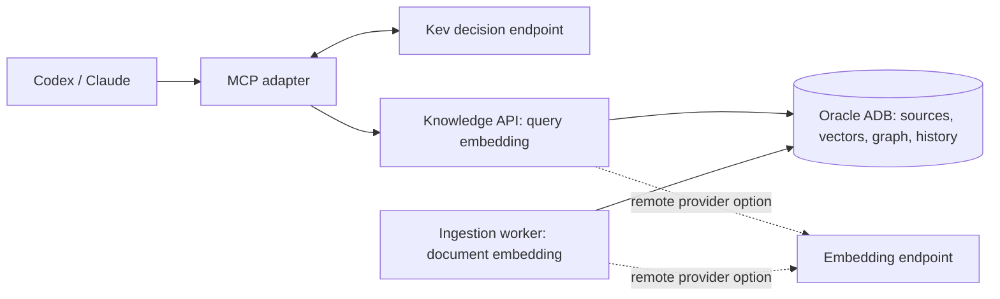

# adb-agent-knowledge

Agent Knowledge for Oracle ADB

English · [한국어](README.md)

An open-source knowledge service for AI agents that makes practical use of Oracle Autonomous AI
Database: source documents, vectors, shared relationships, evidence, and revision history in one database.
Connect Codex or Claude through MCP, or use the notes web interface. Docker is not required.

**Status: v2 preview.** Oracle ADB is the intended production database; SQLite is a test backend,
not a supported production replacement. A complete installation on a fresh ADB with real models
has not yet been validated. MIT covers this project's code, not every model or dependency.

## Where models run

**`EMBEDDING_PROVIDER=local` means local to the Knowledge API and ingestion worker processes.**
It does not mean inside Oracle or automatically on the laptop running Codex/Claude. The MCP adapter
forwards tool calls to the API; it does not compute embeddings. MCP and API can run on different machines.

| Component | Responsibility and execution location |
|---|---|
| Codex / Claude | Uses MCP tools; extracts relationships in default agent mode |
| MCP adapter | Calls the Knowledge API and Kev routing endpoint |
| Knowledge API | Embeds search queries using the configured embedding provider |
| Ingestion worker | Splits sources, embeds chunks, and activates indexed revisions |
| Oracle ADB | Stores sources/vectors and evaluates vector-distance queries; stores relationships/evidence/history |
| Kev service | Separately served decision model for lookup, save, and navigation choices |
| Optional graph worker | Calls a separate generative model only in service mode |

With local embeddings, API and worker each load a model in their own process. Hosting them remotely
keeps embedding computation off the agent user's laptop. With `EMBEDDING_PROVIDER=openai`, both call
an OpenAI-compatible `/embeddings` endpoint instead; Oracle still stores and compares the returned vectors.
This project does not currently configure database-side embedding inference.



## Features and decision flow

- Store text, permitted URLs, PDF/PPTX sources, summaries, and source locations with revision history.
- Search using vectors plus literal substring keyword candidates; this is not Oracle Text/BM25.
- Navigate indexes and evidence-backed relationships; read exact revisions before relying on summaries.
- Record confirmed aliases/external identifiers and review progress for each active source revision.
- Keep source ownership, project scope, temporal evidence, and update conflicts separate.

For optional retrieval, the agent asks Kev whether to look up memory. Retrieval can use direct search,
indexes, or graph context. Explicit requests and clearly needed past context override a mistaken skip.
Kev failures return `agent_review`; scores are not proof that a fact is true.

For storage, the agent checks value and duplicate candidates, reads existing content/history, and chooses
new knowledge or a complete revised version. Saving returns QUEUED; the worker must reach READY before
claiming the source is searchable. Similarity alone never authorizes merging memories or entities.

### v1 and v2

| Mode | Relationship extraction | Separate generative model required? |
|---|---|---|
| v2 default: `GRAPH_EXTRACTION_MODE=agent` | Codex/Claude reads the source and submits relationships | No; agent model usage still applies |
| Optional: `GRAPH_EXTRACTION_MODE=service` | Graph worker calls the configured provider | Yes |

The original service-based implementation is preserved under the `v1` Git tag. Kev and embeddings remain
in both modes. In agent mode, a web/API upload alone does not perform relationship extraction: an agent
must follow up. Service mode supports unattended extraction. Existing service extraction jobs are retained
when switching to agent mode, but are not processed there. HTTP paths remain `/api/v1`.

## Models

**The v2 default is Kev + an embedding model + the Codex/Claude model you already use.** No separate
generative model installation is required for agent-led relationship extraction.

| Role | Model and settings | Where it runs and what it does |
|---|---|---|
| Lookup, capture and navigation decisions | `jaredpalmer/kev-4b`; `KEV_RUN` / `KEV_URL` | Separate Kev service scores choices |
| Document and query embeddings | `dragonkue/snowflake-arctic-embed-l-v2.0-ko`; `EMBEDDING_MODEL` | API/ingestion worker hosts by default, or a remote embedding endpoint; produces 1024-dimensional vectors |
| **Relationship extraction — default agent mode** | **Your Codex/Claude model**; `GRAPH_EXTRACTION_MODE=agent` | **The calling agent reads sources, extracts relationships and submits them through MCP for validation/storage** |

Oracle stores and compares the generated vectors; the embedding model itself does not execute database searches.

**Optional service mode:** only for extraction without an agent, set `GRAPH_EXTRACTION_MODE=service` and
`GRAPH_AUTO_ENABLED=true`. The graph worker then calls a separate model endpoint using `GRAPH_AUTO_MODEL`.
Gemma 4 E2B is an installation example for this mode, not a default or required v2 model.

The database currently requires **1024-dimensional** embeddings. Local defaults are CPU, 384-token chunks,
48-token overlap, and the model's query prompt. API and worker must use matching embedding profiles.
Changing models, revisions, or preprocessing requires a migration/reindexing plan; automatic profile
migration and zero-downtime re-embedding are not implemented.

[Model architecture and configuration](docs/en/architecture-and-models.md) explains execution boundaries,
remote providers, model sources, and limitations.

## Install and start

Use macOS/Linux with access to an existing Oracle ADB and its extracted Wallet. Windows/WSL fresh Oracle
and model setup has not been verified. Setup does not create the database or grant administrative rights.

```sh
git clone https://github.com/devmrko/adb-agent-knowledge.git
cd adb-agent-knowledge
./scripts/setup.sh
```

Setup installs the pinned Python environment and creates `.env` without overwriting an existing one.
Set `USER_NAME`, `USER_PASSWORD`, `WALLET_PASSWORD`, `WALLET_DIR`, and `ORACLE_DSN`. The Wallet directory
must contain `tnsnames.ora` and `ewallet.pem`; DB and Wallet passwords may differ. Retain the pinned embedding
revision from `.env.example`. Never commit credentials or Wallet files.

```sh
./scripts/setup_kev.sh
./scripts/run_knowledge.sh --migrate --kev
```

Omit `--kev` when using an already-running or remote Kev service. Migrations create/upgrade application
tables, not the database or RDF network. Oracle DDL commits implicitly: back up and review upgrades on
existing databases, and stop incompatible writers while applying them.

- Notes: http://127.0.0.1:8000/knowledge
- API documentation: http://127.0.0.1:8000/docs
- Development bearer token: generated `DEV_API_TOKEN` in `.env`.

The default loopback development authentication represents one developer, not production multi-user
isolation. Configure production authentication and HTTPS before exposing the service.

### Enable Oracle graph capabilities

```sh
./uvw run python -m scripts.prepare_knowledge_rdf
./uvw run python -m scripts.setup_property_graph          # inspect only
./uvw run python -m scripts.setup_property_graph --apply  # optional graph/view installation
```

After successful setup, set `WORKFLOW_RDF_ENABLED=true` and, if installed, `PROPERTY_GRAPH_ENABLED=true`.
Restart API/worker with the updated configuration. Existing RDF namespaces are checked, not blindly replaced.
[English Oracle graph examples](docs/en/oracle-graph-examples.md) cover creation and queries.

### Connect an agent

```sh
./.venv/bin/python scripts/install_agent.py codex --register-mcp
./.venv/bin/python scripts/install_agent.py claude --register-mcp
```

Default MCP registration: `adb_agent_knowledge`; choose another with `--mcp-name`. Skill:
`adb-agent-knowledge`. Configure SSH or the Knowledge API endpoint for remote deployments; this is separate
from model endpoints. Reconnect the client after registration/tool changes. Installing a skill does not
itself authorize automatic memory capture. [Detailed installation guide, Korean](docs/guides/agent-installation.md).

## Identity, graph review, and Oracle roles

Resolve existing canonical keys and source-backed aliases/external identifiers before creating entities.
Label similarity is only a hint. Conflicting external bindings require explicit versioned correction;
ambiguous aliases never trigger automatic entity merging. Binding history remains available, and stale
source evidence is excluded from confirmed matching until refreshed.

Current source revisions enter a review backlog. Agents explicitly record REVIEWING, COMPLETE/RELATIONS,
COMPLETE/NONE, or FAILED/UNRESOLVED. Older unreviewed sources are also discoverable. Completion records
an agent's assessment, not a proof that every possible relationship was found. `vk0010` adds these tables.

Canonical relational tables own identities and versions. RDF represents assertion versions and evidence;
SQL Property Graph is an optional read projection used for traversal candidates. `knowledge_graph_explore`
distinguishes evidence links and incoming dependency paths. Paths identify things to investigate, not proven
impact. Arbitrary SPARQL and ontology inference are not implemented.

## Documentation and validation

- [English documentation index](docs/en/README.md)
- [Korean documentation index](docs/README.md)
- [Repository layout](docs/guides/repository-layout.md)
- [Release validation limits](docs/reference/public-release-validation.md)
- [Third-party licenses](THIRD_PARTY.md)

```sh
./uvw run ruff check .
./uvw run ruff format --check .
./uvw run mypy
./uvw run pytest
```

Tests using SQLite validate application behavior, not native Oracle RDF execution or model quality.
Source availability and configured providers must be checked in each deployment. Models and runtime licenses
are separate from the [MIT project license](LICENSE).
