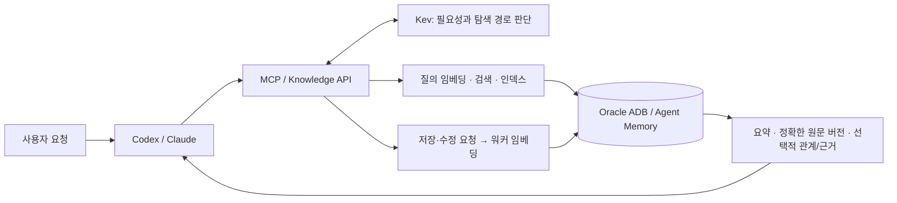

# adb-agent-knowledge

**Oracle Autonomous AI Database를 활용해 AI 에이전트가 이전 지식과 작업 맥락을 다시 찾고, 근거와 함께 활용하도록 만드는 오픈소스 지식 서비스입니다.**

[English](README.en.md) · 한국어 · [알파 릴리스](docs/releases/v0.3.0-alpha.1.md) · [전체 문서](docs/README.md)

Codex·Claude에 MCP(Model Context Protocol)로 연결해 프로젝트 결정, 해결 방법, 업무 문서를 저장하고 검색합니다.
한국어 벡터 검색으로 표현이 달라도 관련 내용을 찾고, 인덱스와 그래프로 연결된 지식의 근거까지 따라갑니다.
Oracle의 관계형 데이터·벡터·RDF·SQL Property Graph와 Agent Memory를 함께 사용하는 실제 구현 예제이기도 합니다.

**현재 버전: `v0.3.0-alpha.1`.** 개인·개발 환경에서 시험하고 피드백을 받는 알파입니다.
Oracle ADB가 필요하며 다른 운영 DB용 어댑터는 없습니다. Docker는 필수가 아닙니다.
[검증 범위와 남은 일](docs/releases/v0.3.0-alpha.1.md)을 확인하세요.

## 어떤 문제를 해결하나요?

에이전트와 오래 작업해도 이전 대화의 결정이나 다른 프로젝트에서 해결한 방법이 다음 요청에 항상 남아 있지는 않습니다.
이 서비스는 그런 정보를 대화 밖에 보관하고, 필요한 때 찾아 작업에 다시 사용할 수 있게 합니다.

예를 들어 **“이 프로젝트를 지난번에는 어떻게 배포했지?”**라고 물으면 배포 기록을 찾고,
요약에서 정확한 원문 버전으로 내려가 확인합니다. 관계가 등록돼 있다면 사용 서비스·배포 환경·연결된 프로젝트도
근거와 함께 살펴볼 수 있습니다. 내용을 정정할 때는 같은 지식의 새 버전을 만들고 이전 기록을 남깁니다.

| 사용 장면 | 도움이 되는 점 | 사용하는 기능 |
|---|---|---|
| 다른 말로 이전 결정을 질문 | 정확한 단어를 기억하지 못해도 관련 내용을 찾기 | 벡터 + 키워드 검색 |
| 여러 세션·머신에서 작업 | 같은 인증 사용자로 공통 지식 참조 | 원격 API/MCP, 사용자 소유권·프로젝트 범위 |
| 문서가 많아 전체를 읽기 어려움 | 요약부터 필요한 원문과 연결 지식으로 이동 | 인덱스·출처·관계 경로 |
| 이전 잘못된 안내를 반복 | 답변 전 기억 확인 절차와 승인된 원칙 전달 | 클라이언트 훅 + Kev |
| 내용이 바뀌거나 근거가 궁금함 | 변경 전후와 어떤 원문에 근거했는지 확인 | 원문 버전·감사 이력·근거 참조 |

이 구조는 반복 설명과 불필요한 전체 문서 읽기를 줄이는 데 목적이 있습니다.
토큰·응답 시간·정확도가 모든 요청에서 개선된다는 보장은 없으며, 데이터와 검색 품질에 따라 달라집니다.
조직 전체가 공유하는 권한 체계나 업무 조건 자동 판정은 현재 완성된 기능이 아닙니다.

## 어떤 기술이 무엇을 하나요?

| 구성요소 | 맡은 역할 | 실행 위치 / 준비 |
|---|---|---|
| Codex·Claude | 도구 호출, 원문 확인, 새 저장/보완 선택, 기본 모드의 관계 추출과 답변 | 사용하는 에이전트 클라이언트 |
| MCP + Python API·워커 | 인증, 저장·검색 요청, 비동기 색인, 버전·근거 검증 | 로컬 머신 또는 원격 서버 |
| **Kev** (`jaredpalmer/kev-4b`) | 조회·저장 필요성과 직접 검색·인덱스·그래프 경로에 점수 제공 | 별도 로컬/원격 판단 서비스 |
| **한국어 임베딩** (`dragonkue/snowflake-arctic-embed-l-v2.0-ko`) | 문서 청크와 질문을 1024차원 벡터로 변환 | 기본은 API·워커 머신, 원격 제공자 선택 가능 |
| **Oracle Autonomous AI Database** | 벡터 비교, 사용자·지식·버전·이력·관계 데이터 보관 | 사용자가 준비한 ADB |
| **Oracle AI Agent Memory** | v3 업무 원문·청크·벡터 저장, 별도 에이전트 경험 기억 | ADB 내부 저장소, Python 라이브러리로 접근; 별도 초기화 |
| **RDF / SQL Property Graph** | RDF는 관계·근거 표현과 검증, Property Graph는 관계 테이블 기반 탐색 | 선택적 DB 기능 초기화 |
| 웹 노트 화면 | 지식·기억·관계 조회, 사용자 원칙 관리 | API의 `/knowledge` |

**임베딩 모델은 Oracle DB 안에서 실행하지 않습니다.** API·워커가 벡터를 생성하거나 원격 제공자에서 받아
Oracle에 저장·질의합니다. 서버에 모델을 두면 에이전트 사용자의 랩탑에는 설치할 필요가 없습니다.
현재 검색은 벡터와 부분 문자열 키워드 후보를 결합하며 Oracle Text/BM25는 아닙니다.

기본 `GRAPH_EXTRACTION_MODE=agent`에서는 사용 중인 Codex·Claude가 관계를 추출하므로 별도 생성형 LLM 서버가
필수는 아닙니다. 무인 처리가 필요한 선택적 `service` 모드만 별도 모델 endpoint를 호출합니다.
Kev는 임베딩·답변 생성·사실 확인을 대신하지 않으며 점수는 사실의 정답 확률이 아닙니다.

[모델 설정·실행 위치](docs/guides/local-models.md) · [v3 저장·검색 구조](docs/guides/v3-primary-store.md) · [직접 벡터 테이블과 비교: 속도·임베딩·운영](docs/guides/storage-backends.md) · [RDF·Property Graph 예제](docs/guides/oracle-graph-examples.md)

## 어떻게 저장하고 조회하나요?



- **조회:** 필요한 기억을 판단 → 검색/인덱스 탐색 → 필요하면 그래프 확장 → 원문·근거 확인 → 답변과 작업에 반영합니다.
- **저장:** 저장 가치·유사 항목 확인 → 기존 원문과 이력 확인 → 새 항목 또는 새 버전 선택 → 워커가 색인 → `READY` 확인입니다. 비슷하다는 이유만으로 자동 병합하지 않습니다.
- **구분:** 업무 지식은 문서·절차·결정, 에이전트 메모리는 경험·기억 관계, 사용자 원칙은 승인된 행동 설정입니다. v3가 Agent Memory 저장 기술을 쓰더라도 이 목적 구분과 기존 지식 ID·이력은 유지합니다.
- **관계:** 여러 노트가 공통 개체·관계를 공유하고 정확한 원문 버전·인용을 근거로 남깁니다. 그래프 경로는 연결을 나타내며 인과관계나 업무 규칙 충족의 증명은 아닙니다.

MCP만 연결하면 도구 호출 여부는 에이전트가 선택합니다. **매 요청에서 기억 확인을 빠뜨리지 않으려면 클라이언트 훅도 설치해야 합니다.**
활성화된 훅은 승인된 사용자 원칙을 전달하고 Kev 판단에 따라 기억을 조회합니다. 훅 자체는 지식을 저장하지 않으며 모델의 완전한 준수도 보장하지 않습니다.

[자세한 저장·조회 흐름](docs/guides/storage-retrieval-flow.md) · [기억 확인 훅과 설치 이유](docs/guides/required-memory-hook.md) · [사용자 원칙 관리](docs/guides/user-principles.md)

## 시작하기

아래는 **새 앱 스키마에서 v3를 시작하는 경로**입니다. 기존 데이터가 있으면 먼저 [이관·복구 안내](docs/guides/v3-primary-store.md)를 따르세요.
Git, Python 3/venv와 기존 Oracle ADB·앱용 DB 계정·Wallet이 필요합니다. macOS/Linux 설치 경로이며,
Windows 네이티브와 모든 CPU/GPU 조합을 지원 검증한 것은 아닙니다. [OS·모델 준비](docs/guides/runtime-installation.md).

```sh
git clone --branch v0.3.0-alpha.1 https://github.com/devmrko/adb-agent-knowledge.git
cd adb-agent-knowledge
./scripts/setup.sh --with-agent-memory --with-models
```

설치기는 프로젝트 환경을 준비합니다. ADB 서비스·사용자 계정은 생성하지 않습니다.
생성된 `.env`에서 `USER_NAME`, `USER_PASSWORD`, `WALLET_DIR`, `WALLET_PASSWORD`, `ORACLE_DSN`을 채웁니다.
DB 비밀번호와 Wallet 암호는 다를 수 있습니다. 첫 모델 사용에는 다운로드·디스크·메모리가 필요합니다.
원격 Kev/임베딩을 사용하면 `--with-models`를 생략하고 [endpoint 설정](docs/guides/portable-setup.md)을 적용합니다.

```sh
./.venv/bin/alembic upgrade head
./.venv/bin/python -m scripts.source_transfer init
```

마이그레이션은 앱 테이블·이력·감사 트리거를 준비합니다(현재 `vk0016`). 다음 명령은 별도 v3 원문 저장소를 초기화합니다.
이후 `.env`에 `KNOWLEDGE_SOURCE_BACKEND=v3`를 설정하고 실행합니다. 기본 설정은 호환성을 위해 `legacy`이므로 명시적 전환이 필요합니다.

```sh
./scripts/run_knowledge.sh --kev
```

원격 또는 이미 실행 중인 Kev를 쓰면 `--kev`를 생략합니다.
검색 화면은 **http://127.0.0.1:8000/knowledge**, API 설명은 `/docs`, 상태 확인은 `/actuator/health`입니다.
API·워커를 실행한 상태에서 에이전트를 연결합니다.

```sh
./.venv/bin/python scripts/install_agent.py codex --register-mcp
# Claude를 사용한다면:
./.venv/bin/python scripts/install_agent.py claude --register-mcp
```

MCP 기본 이름은 `adb_agent_knowledge`이고 `--mcp-name`으로 변경할 수 있습니다.
새 에이전트 세션에서 짧은 테스트 메모 저장을 요청하고 `READY` 확인 후 다른 표현으로 찾아보세요.
검색 결과의 정확한 원문을 읽어 저장 내용과 일치하는지 확인하면 기본 저장·조회 경로를 점검할 수 있습니다.

**선택 기능은 별도 준비가 필요합니다:** [RDF·Property Graph](docs/guides/oracle-graph-examples.md),
[에이전트 경험 기억](docs/guides/agent-memory.md), [Codex·Claude 훅 등록·신뢰 확인](docs/guides/required-memory-hook.md).
Oracle 비용·에이전트 사용료·선택한 원격 모델 비용은 각 서비스 조건을 따릅니다. 키·Wallet·`.env`는 공개하지 마세요.
기본 실행은 개인 로컬 개발 설정이며 원격 공개에는 인증·HTTPS 구성이 필요합니다.

## 더 자세히 보기

| 알고 싶은 내용 | 다음 문서 |
|---|---|
| 처음 설치하고 첫 저장·검색까지 | [빠른 시작](docs/guides/quickstart.md), [v3 설치](docs/guides/v3-primary-store.md) |
| 모델·실행 위치·다른 머신 연결 | [구성 선택](docs/guides/portable-setup.md), [여러 머신](docs/guides/multi-machine-memory.md) |
| 에이전트와 매 요청 기억 확인 연결 | [MCP·스킬](docs/guides/agent-installation.md), [훅](docs/guides/required-memory-hook.md) |
| 관계를 만들고 SQL로 조회 | [Oracle 그래프 실습](docs/guides/oracle-graph-examples.md), [관계·근거 검색](docs/guides/related-retrieval.md) |
| 저장 위치·검색 방식·식별자 | [Agent Memory와 앱 테이블 비교](docs/guides/storage-backends.md), [v3 원문](docs/guides/v3-primary-store.md) |
| 변경·장애·운영 | [변경 이력](docs/guides/change-history.md), [개발·복구](docs/guides/knowledge-development.md) |
| 설계 이유와 코드 구조 | [아키텍처 흐름](docs/guides/storage-retrieval-flow.md), [저장소 구조](docs/guides/repository-layout.md) |
| 알파 검증과 앞으로 할 일 | [릴리스 안내](docs/releases/v0.3.0-alpha.1.md), [전체 문서 색인](docs/README.md) |

## 알파 범위와 지원

빈 스키마의 Oracle 초기화, 실제 임베딩 검색, 원문 수정·이력, 관계 조회와 격리된 장애 복구 시험을 수행했습니다.
검증 환경과 측정 한계는 [릴리스 안내](docs/releases/v0.3.0-alpha.1.md)에 구분해 기록합니다.
장애 후 작업 복구에는 운영자 절차가 필요하며 자동 무중단 복구는 제공하지 않습니다.
Oracle Text/BM25, OCR, 자동 모델 교체·재임베딩, 완성된 조직 공유 ACL과 업무 조건 평가 엔진은 포함하지 않습니다.

문제·제안은 [GitHub Issues](https://github.com/devmrko/adb-agent-knowledge/issues)에 재현 절차와 버전을 남겨주세요.
비밀번호·원문 개인정보·Wallet을 첨부하지 마세요. 유지보수: [devmrko](https://github.com/devmrko).
개발 기여는 [구조와 검증 명령](docs/guides/repository-layout.md)을 확인하세요.

코드는 [MIT](LICENSE)입니다. 모델 가중치·의존성·외부 서비스는 각각의 이용 조건을 따릅니다. [외부 구성요소](THIRD_PARTY.md).
