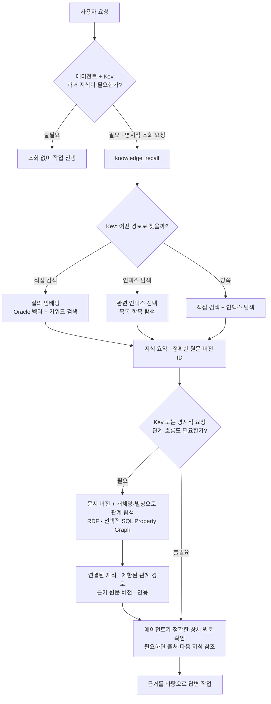
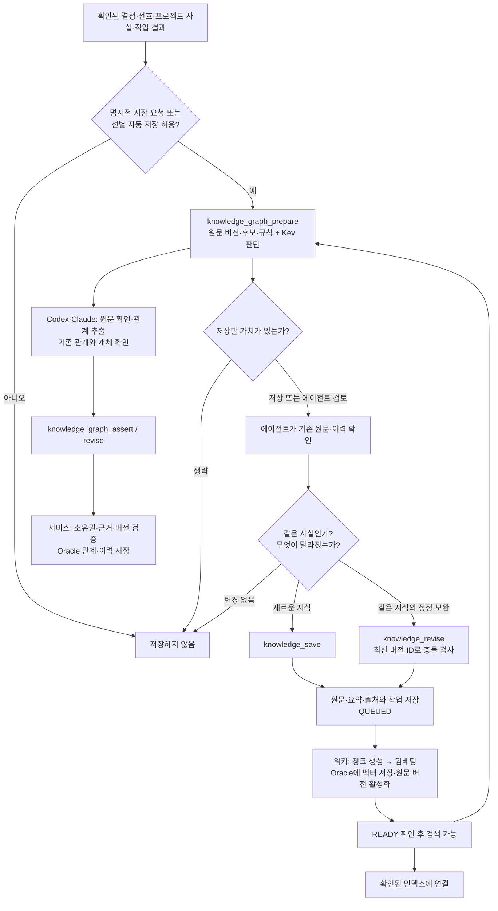
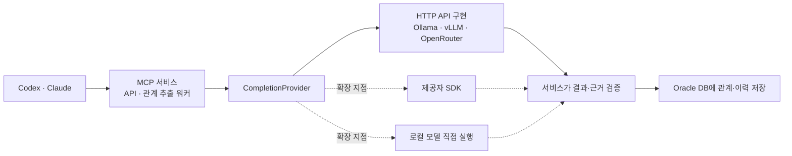

# adb-agent-knowledge

Agent Knowledge for Oracle ADB

**Codex·Claude 등 AI 에이전트를 위한 지식 저장소 — Kev 판단, 벡터·그래프 검색, 근거와 변경 이력.**

Oracle Autonomous AI Database에 원문과 벡터를 보관하고, 한국어로 검색합니다.
브라우저에서 직접 찾아보거나 Codex·Claude에 연결해 이전 결정과 해결 방법을 활용할 수 있습니다.
Kev가 조회·저장과 검색 경로를 판단합니다. 모델은 로컬 또는 원격으로 연결하며 Docker는 필수가 아닙니다.

**필수 저장소: Oracle Autonomous Database.** 현재 Oracle 벡터·RDF·SQL Property Graph에 맞춘 구현이며 다른 DB로 교체하는 어댑터는 제공하지 않습니다. SQLite는 테스트용입니다.

**릴리스 상태: v2 preview (0.2.0).** 새 Oracle ADB의 전체 설치 검증은 아직 완료하지 않았습니다.

**새 사용자:** [설치 구성과 모델 선택](docs/guides/portable-setup.md)부터 확인하세요.

[시작하기](docs/guides/quickstart.md) · [검색 화면](docs/guides/search-ui.md) · [Codex / Claude 연결](docs/guides/agent-installation.md) · [다른 머신에 적용](docs/guides/multi-machine-memory.md) · [전체 문서](docs/README.md)

## v2: 별도 생성형 LLM 운영을 줄이는 기본 구성

기존 서비스 내부 LLM 추출 방식은 [`v1` 태그](https://github.com/devmrko/adb-agent-knowledge/tree/v1)로 보존합니다.
v2 기본값은 `GRAPH_EXTRACTION_MODE=agent`입니다. **Codex·Claude가 관계를 추출하고 MCP 서비스가
검증·저장합니다.** 별도 Gemma/Ollama/OpenRouter 설치·연결은 필요하지 않습니다.
Kev의 조회·저장·인덱스·그래프 판단과 임베딩 모델은 그대로 유지합니다.

| 역할 | v2 기본 `agent` | 선택적 `service` (v1 방식) |
|---|---|---|
| 조회·저장·탐색 판단 | Kev 유지 | Kev 유지 |
| 벡터 생성 | 임베딩 모델 | 임베딩 모델 |
| 관계 추출·의미 확인 | 호출하는 Codex·Claude | 별도 생성 모델과 그래프 워커 |
| 관계 검증·이력·저장 | MCP 서비스와 Oracle | MCP 서비스와 Oracle |
| 웹 업로드 후 무인 관계 추출 | 에이전트 후속 요청 필요 | 설정된 워커가 처리 |

agent 모드에서도 LLM은 에이전트 쪽에서 사용하며 해당 사용량은 발생합니다.
[구체적인 흐름·설정·v1 전환 안내](docs/guides/v2-agent-extraction.md)를 확인하세요.

## 할 수 있는 일

| 기능 | 동작 |
|---|---|
| 지식 저장 | 텍스트·URL·PDF·PPTX 원문을 저장하고 비동기로 임베딩 |
| 한국어 검색 | 벡터와 키워드 검색을 결합해 관련 지식과 원문 반환 |
| 출처 관리 | 머신 ID와 파일·Git·객체 위치를 버전별로 기록 |
| 요약·인덱스·근거 | Kev로 검색 경로 선택, 여러 인덱스와 원본 위치 연결 ([사용법](docs/guides/index-navigation.md)) |
| 변경 이력·이벤트 | 트리거로 변경 전후 기록, 후속 처리와 근거 재검토 ([사용법](docs/guides/change-history.md)) |
| 공통 RDF 관계 | 여러 노트·프로젝트의 관계를 연결하고 업무/기록 시점별 조회 ([설치](docs/guides/shared-graph.md)) |
| 기억 갱신 | 기존 지식을 보충·수정하고 이전 버전 보존 |
| 사용자별 관리 | 사용자 소유권과 프로젝트 범위로 구분 |
| 에이전트 연결 | MCP + 공통 스킬로 검색·저장·수정; Kev 기본 판단 계층 |

## 워크플로우와 의사결정

에이전트가 매 요청에서 저장된 지식의 필요성을 판단하고, 필요한 경우 MCP 도구를 호출합니다.
**Kev는 조회·저장 필요성과 탐색 경로에 점수를 주는 판단 모델**입니다. 답변 작성, 임베딩 생성,
원문을 읽고 기존 지식을 보충할지 결정하는 일, 관계 추출은 각각 다른 역할입니다.
이 흐름은 스킬 지침과 도구 호출로 동작하며, 모든 대화를 가로채는 강제 실행 훅은 아닙니다.

### 조회: 필요한 기억을 찾고 근거까지 확인



`knowledge_decide(operation="lookup")`로 선택적 조회 여부를 먼저 판단할 수 있습니다.
`knowledge_recall`은 직접 검색·인덱스·양쪽 경로를 선택하고, 특정 질의는 `knowledge_search`로
바로 검색할 수 있습니다. 관계 조회는 `graph_mode=auto/always/never`로 제어합니다.
인덱스가 비거나 라우팅이 불확실하면 직접 검색 등의 대체 경로를 제공합니다.

예를 들어 **“지난번 이 프로젝트를 어떻게 배포했지?”**라는 요청은 배포 기록을 검색하고,
필요하면 프로젝트·서비스·배포 환경의 관계와 당시 근거를 따라갑니다. 전체 문서를 한꺼번에
읽는 대신 **요약 → 상세 지식 → 필요한 원본·연결 지식** 순서로 확인합니다.

### 저장: 새로 저장할지, 기존 지식을 보완할지 판단



`knowledge_prepare_save`는 후보를 찾는 준비 단계이며 데이터를 쓰지 않습니다. **새 저장과 기존 지식
수정의 최종 선택은 원문을 확인한 에이전트가 합니다.** 비슷한 문서를 서버가 임의로 합치지는 않습니다.
수정은 새 버전을 만들고 이전 기록을 보존합니다. `QUEUED`는 접수 상태이며 `READY` 확인이 필요합니다.

v2 기본 모드의 관계 추출은 Codex·Claude가 수행합니다. Kev는 필요성을 판단하며 관계 자체를
만들지 않습니다. 별도 생성 모델을 쓰는 `service` 모드에서는 `review`·`auto_existing`·
`auto_verified` 정책이 적용됩니다. 원문이 수정되면 이전 버전만 근거로 하는 관계는 현재 조회에서
제외되며, 에이전트 재검토 또는 서비스 재추출로 새 근거를 반영합니다. 과거 기록은 보존합니다.

### 누가 무엇을 결정하나

| 담당 | 역할 |
|---|---|
| 사용자 | 자동 저장 허용, 명시적 조회·저장 요청, 관계 수정·해제 |
| Codex·Claude 등 에이전트 | 도구 호출, 원문·이력 확인, 신규 저장 또는 보완 선택, 근거 기반 답변 |
| Kev | 조회·저장 필요성, 직접 검색·인덱스·그래프 경로, 관계 추출 필요성 판단 |
| 임베딩 모델 | 원문 청크와 질의를 벡터로 변환 |
| 관계 추출 | 기본은 Codex·Claude, service 모드에서만 별도 생성 모델 |
| API·워커·Oracle | 인증·소유권·버전 충돌 검사, 비동기 색인, 관계·근거·변경 이력 보존 |

명시적 조회 요청과 필요한 과거 맥락은 Kev의 잘못된 생략 판단보다 우선합니다. 저장 금지와 비밀정보
제외는 모델 점수보다 우선하며, Kev 장애·불확실성은 `agent_review`로 돌려 에이전트가 판단합니다.
모델 점수는 사실의 정확도를 보증하지 않고, 그래프 경로도 인과관계의 증명은 아닙니다.
웹 화면에서 사용자가 직접 수행하는 저장·조회는 Kev의 허가를 기다리지 않습니다.

[상세 저장·조회 흐름](docs/guides/storage-retrieval-flow.md) ·
[관계·경로·근거 검색](docs/guides/related-retrieval.md) ·
[자동 관계 설정](docs/guides/automatic-graph.md)

## 선택적 service 모드의 LLM 호출 구조

**`GRAPH_EXTRACTION_MODE=service`에서 MCP 서비스가 공통 인터페이스로 LLM을 호출합니다.**
기본 agent 모드는 이 경로를 실행하지 않습니다. 관계 추출·의미 검토 로직과
모델 연결 방식을 분리했습니다. 내부에서 실제 호출하는 프로세스는 관계 추출 워커입니다.



현재 포함된 구현체는 **OpenAI 호환 HTTP API**이며 `GRAPH_AUTO_PROVIDER=openai_compatible`로
선택합니다. 기존 설정은 이 값이 없어도 같은 HTTP 구현을 사용합니다. 로컬 Ollama 역시 이 방식입니다.
SDK·프로세스 내 직접 실행은 인터페이스를 구현해 추가하는 확장 지점이며 아직 완성된 어댑터는 없습니다.
어댑터를 바꿔도 추출 규칙·의미 검토·DB 저장 정책은 공통 로직을 사용합니다.
[인터페이스·설정·확장 방법](docs/guides/llm-providers.md)

## 설치 전에 준비할 것

`setup.sh`는 Python 환경·의존성과 `.env`를 준비합니다. **DB 생성, RDF 초기화, Kev 설치,
Ollama 실행까지 한 번에 처리하지는 않습니다.** 필요한 기능에 따라 아래 항목을 준비하세요.

| 구성 | 언제 필요한가 | 준비 방식 |
|---|---|---|
| Oracle Autonomous Database · Wallet | 실제 지식 저장·검색 | 사용자가 DB와 접속 계정 준비. 앱이 DB나 사용자 권한을 생성하지 않음 |
| 애플리케이션 테이블 | 최초 실행 | `run_knowledge.sh --migrate` 또는 Alembic으로 생성·업그레이드 |
| 임베딩 모델 | 벡터 저장·검색 | 기본 로컬 모델은 최초 사용 시 다운로드. 별도 모델 서버 없이 API·worker에서 실행 |
| Kev | 기본 의사결정·탐색 경로 | 별도 설치 후 `--kev`로 함께 실행하거나 원격 Kev 연결 |
| Oracle RDF | 관계·근거 저장 및 조회 | 별도 초기화 후 `WORKFLOW_RDF_ENABLED=true` |
| SQL Property Graph | 선택적 그래프 탐색 방식 | 별도 생성 후 `PROPERTY_GRAPH_ENABLED=true` |
| 관계 추출용 생성 모델 | service 모드 무인 처리만 | Ollama/Gemma 별도 실행 또는 OpenRouter 등 호환 API 연결 |

**v2 agent 모드는 별도 생성형 모델을 설치하지 않습니다.** Codex·Claude가 추출한 관계를 도구로
제출합니다. 서비스 무인 처리만 별도 LLM/API를 요구합니다. 벡터 임베딩과 Kev는 두 모드 모두 유지합니다.
모델 가중치는 Git에 포함하지 않습니다. 최초 다운로드에는 인터넷·디스크 공간이 필요하고,
실행 메모리와 속도는 CPU/GPU 및 동시에 실행하는 모델에 따라 달라집니다.

## 기본 모델과 선택 방법

| 역할 | 기본 모델 · 설정 | 하는 일 |
|---|---|---|
| 의사결정 | `jaredpalmer/kev-4b` · `KEV_RUN` | 짧은 요청·맥락과 질문을 받아 조회·저장·탐색 선택지에 점수를 반환 |
| 한국어 벡터 검색 | `dragonkue/snowflake-arctic-embed-l-v2.0-ko` · `EMBEDDING_MODEL` | 문서 청크와 질의를 1024차원 벡터로 변환 |
| 서비스 모드 관계 추출 | 사용자가 선택. 로컬 예제는 Gemma 4 E2B · `GRAPH_AUTO_MODEL` | 원문에서 개체·관계 후보를 추출하고 의미 검토 |

**Kev:** Qwen3.5-4B-Base 기반 LoRA·판단 헤드 모델입니다. 이 서비스는 `/v1/systemone`의
`noul` 점수를 사용하며 Kev가 긴 답변을 생성하지 않습니다. `KEV_MODEL=kev-latest`는 API 요청의
모델 별칭이고 실제 로컬 실행 모델은 `KEV_RUN`으로 지정합니다. 기본 판단 제공자는 Kev이며
장애 시 `agent_review`로 돌아갑니다. 공식 모델 카드의 언어는 English이므로 한국어 업무의
판단 품질과 임계값은 자체 질의로 검증해야 합니다. [Kev 모델 카드](https://huggingface.co/jaredpalmer/kev-4b)

**임베딩:** Snowflake Arctic Embed v2를 한국어 데이터로 추가 학습한 Sentence Transformer입니다.
모델 카드는 한국어·영어, 1024차원, 코사인 유사도를 명시합니다. 이 프로젝트는 고정 revision과
기본 384토큰 청크·48토큰 겹침을 사용하고, 질의용 prompt를 적용합니다.
[임베딩 모델 카드](https://huggingface.co/dragonkue/snowflake-arctic-embed-l-v2.0-ko)

기본 `EMBEDDING_PROVIDER=local`, `EMBEDDING_DEVICE=cpu`이며 호환 환경에서 `mps`·`cuda`를
설정할 수 있습니다. 원격은 `EMBEDDING_PROVIDER=openai`로 OpenAI 호환 `/embeddings`에 연결합니다.
현재 DB 열은 **1024차원**입니다. 모델·revision·청크·전처리를 변경하면 기존 벡터와 호환되지 않을 수
있으며 자동 재임베딩·무중단 전환은 아직 없습니다. [모델 설정](docs/guides/local-models.md) ·
[원격 모델 구성](docs/guides/portable-setup.md#3-모델-연결-선택)

## 시작하기

macOS / Linux 기준입니다. 새 Oracle ADB 계정에는 필요한 테이블·인덱스 생성 권한이 있어야 합니다.

```sh
git clone https://github.com/devmrko/adb-agent-knowledge.git
cd adb-agent-knowledge
./scripts/setup.sh
```

생성된 `.env`의 `USER_NAME`, `USER_PASSWORD`, `WALLET_DIR`, `WALLET_PASSWORD`, `ORACLE_DSN`을
채웁니다. DB 비밀번호와 Wallet 암호는 서로 다를 수 있습니다. [접속 설정](docs/guides/quickstart.md)

### 1. 기본 저장·검색과 Kev 실행

```sh
./scripts/setup_kev.sh
./scripts/run_knowledge.sh --migrate --kev
```

`--migrate`가 원문·청크·벡터·버전·관계 기준 데이터·이력 등의 테이블을 준비한 뒤 API와 워커를
시작합니다. RDF 네트워크와 SQL Property Graph는 이 옵션으로 생성되지 않습니다.
이후에는 `./scripts/run_knowledge.sh --kev`로 실행합니다. 원격 또는 이미 실행 중인 Kev를
사용한다면 `setup_kev.sh`와 `--kev`를 생략합니다. 기존 DB의 DDL은 자동 커밋되므로 적용 내용을 확인하세요.

### 2. RDF 관계 기능 초기화

실행 중인 API·워커를 정상 종료한 뒤, 위 테이블 준비가 끝난 상태에서 실행합니다.

```sh
./.venv/bin/python -m scripts.prepare_knowledge_rdf
```

성공 후 `.env`에 `WORKFLOW_RDF_ENABLED=true`를 설정합니다. 이 도구는 RDF 네트워크·그래프를
준비하며 생성 권한을 자동 부여하지 않습니다. 일부만 초기화된 상태는 중단하고 확인을 요구합니다.

### 3. SQL Property Graph 선택적 활성화

```sh
./.venv/bin/python -m scripts.setup_property_graph          # 권한·객체 확인
./.venv/bin/python -m scripts.setup_property_graph --apply  # View와 Graph 생성
```

성공 후 `.env`에 `PROPERTY_GRAPH_ENABLED=true`를 설정합니다. Oracle 기능 지원과 View·Property
Graph 생성 권한이 필요합니다. 비활성 상태에서는 기존 관계형 테이블 탐색을 사용합니다.

### 4. 자동 관계 추출용 LLM 연결

[Ollama/Gemma 설치](docs/guides/local-full-setup.md) 또는 [호환 API 설정](docs/guides/automatic-graph.md)을
따라 모델을 준비하고 `GRAPH_EXTRACTION_MODE=service`, `GRAPH_AUTO_ENABLED=true`로 활성화합니다. Ollama는 앱 실행 스크립트가
대신 실행하지 않습니다. 로컬 프로필은 `review` 정책으로 시작하며 자동 반영이 필요하면 검증 후
정책을 변경합니다. 그래프를 수동으로 등록·조회하는 데 이 추출용 LLM은 필수가 아닙니다.

설정을 마친 뒤 서비스를 다시 시작합니다. 모델·그래프 초기화까지 한 번에 수행하는 통합 설치 명령은
아직 없으며, [새 ADB 검증 범위](docs/reference/public-release-validation.md)를 확인하세요.

**검색 화면:** http://127.0.0.1:8000/knowledge · **API 문서:** http://127.0.0.1:8000/docs

로컬 개발 화면은 자동 연결됩니다. 원격/운영 환경은 별도 인증·HTTPS를 구성합니다.
기본 실행은 이 머신에서만 접속 가능한 개인 개발 환경이며 토큰과 Wallet은 Git에 올리지 않습니다.

## RDF와 SQL Property Graph를 어떻게 쓰나

한 노트에 그래프를 가두지 않고 여러 지식이 같은 개체·관계를 공유합니다. 예를 들어 다음 관계를
정확한 원문 버전과 인용으로 뒷받침합니다. 아래는 설명용 예시이며 미리 들어 있는 데이터는 아닙니다.

```text
프로젝트 A ── uses ─────────▶ 공통 인증 서비스
프로젝트 B ── uses ─────────▶ 공통 인증 서비스
공통 인증 서비스 ─ deployed_on ─▶ 서버 X
```

| 계층 | 저장·조회 역할 |
|---|---|
| 관계형 테이블 `vk_g_*` | 개체·관계·관계 버전·원문 근거의 기준 데이터. 소유권·기간·상태를 관리 |
| Oracle 네이티브 RDF | 공통 관계와 근거를 RDF로 기록. 서비스 조회 시 RDF accessor로 관계 버전을 검증 |
| SQL Property Graph `VK_KNOWLEDGE_GRAPH` | 기존 관계 테이블을 바탕으로 정의한 선택적 그래프. `GRAPH_TABLE`로 인접 관계 후보를 조회 |

Property Graph를 위해 별도 그래프 DB에 데이터를 복제하지 않습니다. 테이블의 변경을 같은 기반
데이터 위에서 조회하며, 최종 결과에는 서비스의 사용자·범위·시점·현재 근거 필터가 적용됩니다.
관계 추출은 LLM/에이전트가 하고, RDF나 Property Graph 자체가 문서를 읽어 관계를 추론하지는 않습니다.

**사용 예:** “프로젝트 A가 쓰는 서비스와 배포 위치를 보여줘”라고 요청하면, 에이전트가 개체를
확인하고 관계를 확장해 연결 경로와 근거 원문을 받습니다. 일반 지식 검색은
`graph_mode=always`로 관계를 함께 요청할 수 있고, 직접 그래프 검색에는 다음과 같이 범위를 지정합니다.

`POST /api/v1/graph/search` 요청 본문:

```json
{
  "query": "프로젝트 A",
  "scopes": ["global", "project:a", "project:b"],
  "direction": "outgoing",
  "predicates": ["uses", "deployed_on"],
  "depth": 1,
  "max_edges": 20
}
```

해당 API는 인증이 필요합니다. `depth=1`은 직접 관계와 추가 한 단계, 최대 2개 edge 경로를 뜻합니다.
응답의 `paths`, `related_knowledge`, 각 관계의 `evidence`로 경로·연결된 원문·정확한 인용을 확인합니다.
개체 탐색은 현재 이름·별칭 기반이며, 임의 자연어를 완벽히 이해하는 그래프 질의 엔진은 아닙니다.
웹의 ‘관련 그래프’와 노트의 ‘연결된 지식’에서도 확인할 수 있습니다.

`valid_at`은 업무 시점, `known_at`은 당시 기록 시점 조회에 사용합니다. 날짜는 근거 없이 추정하지
않으며 이 필터가 일반 벡터 검색 전체에 적용되는 것은 아닙니다. 관계 경로는 연결을 보여주며,
자동으로 인과관계나 장애 영향을 증명하지 않습니다. [관계 검색 상세](docs/guides/related-retrieval.md)

## Codex / Claude에서 사용하기

공개 저장소 이름과 연결 식별자는 다음처럼 구분합니다. MCP 이름은 설치 시 선택할 수 있으며 기본값은 `adb_agent_knowledge`입니다.
스킬 폴더와 호출명도 `adb-agent-knowledge`로 통일했습니다.

| 구분 | 이름 |
|---|---|
| Git 저장소 · 체크아웃 폴더 · Python 프로젝트 | `adb-agent-knowledge` |
| 제품 설명 | Agent Knowledge for Oracle ADB |
| MCP 서버 등록명 | `adb_agent_knowledge` |
| 스킬 이름 · 폴더 | `adb-agent-knowledge` |
| Python 애플리케이션 모듈 | `knowledge_app` |


서비스를 실행한 상태에서 원하는 클라이언트를 연결합니다.

```sh
./.venv/bin/python scripts/install_agent.py codex --register-mcp
# 또는
./.venv/bin/python scripts/install_agent.py claude --register-mcp
```

다른 MCP 이름은 위 명령에 `--mcp-name personal_knowledge`를 추가해 선택합니다.
기존 `vector_knowledge` 연결은 자동으로 변경하지 않습니다.

새 세션에서 연결을 확인하세요. 자동 저장은 별도 사용자 동의를 전제로 하며,
동일 지식의 보충·정정은 에이전트가 원문과 이력을 확인해 기존 항목을 수정합니다.
[설치·업데이트·자동 저장 안내 →](docs/guides/agent-installation.md)

## 저장소 구조

```text
knowledge_app/                 API · MCP · 검색 · 웹 화면
migrations/                    지식 저장소 DB 마이그레이션
skills/adb-agent-knowledge/       Codex / Claude 공통 스킬
scripts/                       설치 · 실행 · 평가 도구
tests/                         지식 서비스 테스트
docs/                          사용 안내 · 설계 · 검증 결과
packages/python-foundation/    공통 기반 라이브러리와 자체 예제/테스트
alembic.ini                    지식 저장소 마이그레이션 설정
pyproject.toml / uv.lock       서비스 의존성 + 로컬 workspace
```

일반 사용자는 `.env`, `scripts/setup.sh`, `scripts/run_knowledge.sh`, `scripts/install_agent.py`부터
보면 됩니다. `config/`는 선택 기능의 설정 예제, `skills/`는 에이전트 설치 자료입니다.
`knowledge_app/`, `migrations/`, `tests/`는 개발·운영 코드이고 `.github/workflows/`는 자동 검사입니다.

`packages/python-foundation/`은 실제 사용 중인 인증·트랜잭션·오류 처리 라이브러리입니다.
독립 예제와 테스트까지 이 폴더에 격리했으며 일반 사용자는 따로 설치하거나 수정할 필요가 없습니다.
`pyproject.toml`은 프로젝트·의존성 설정, `uv.lock`은 버전 고정, `uvw`는 전역 설치가 필요 없는 uv 실행기입니다.
AGENTS.md·CLAUDE.md는 개발 에이전트 지침이며 지식 데이터 사본이 아닙니다.

실행 경로 호환성을 위해 `scripts/`는 유지하되 [명령 용도별 안내](scripts/README.md)로 구분합니다.
[개발 구조와 검증 명령 →](docs/guides/repository-layout.md)

## 현재 범위

- 기존 지식 보충은 이력을 보존하는 수정입니다. 서버가 유사 문서를 자동 병합하지는 않습니다.
- 한국어 리랭커는 선택 기능이며 실험 결과를 반영해 **기본 비활성**입니다.
- 자동 생성 요약, OCR, Oracle Text/BM25는 아직 지원하지 않습니다.
- 운영 다중 사용자 환경에는 별도 JWT·TLS 구성이 필요합니다.

[검색 평가](docs/guides/search-evaluation.md) · [실측 결과와 한계](docs/reference/knowledge-validation.md)

자동 그래프: [추출 모델 설정·후보 검토·운영 안내](docs/guides/automatic-graph.md)

## 라이선스

프로젝트 코드는 [MIT](LICENSE)입니다. 모델 가중치, 외부 서비스와 의존성은 각자의 라이선스·이용 조건을 따릅니다. [외부 구성 요소](THIRD_PARTY.md)를 참고하세요.
