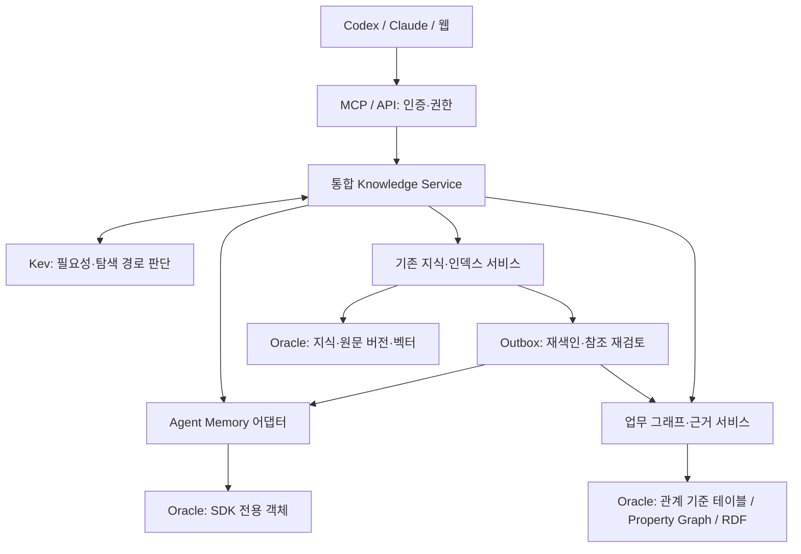

# 0034 — Agent Memory 통합과 ID·이름 설계

상태: 단계적 구현. 2026-11-02 1차 SDK 통합을 배포했고 2차 근거·관계 기능을 구현했다.
아래는 목표 설계와 구현 경계를 함께 기록한다. 실제 계약은 guides/agent-memory.md 및 설계0035를 따른다.
근거: [SDK 실험](../../../experiments/oracle-agent-memory/README.md), [실험 설계](../0033-oracle-agent-memory-spike/design.md).

## 1. 목적과 경계

기존 MCP, Kev, 업무 지식과 그래프를 유지하면서 Oracle AI Agent Memory SDK를
선택 가능한 에이전트 기억 어댑터로 추가한다. 공식 패키지는 oracleagentmemory이며,
일반 OCI 관리 SDK와 구분한다. 사용자·에이전트·대화의 기억과 업무 지식은 연결하되
같은 본문을 두 저장소에 자동 복제하지 않는다.

| 데이터 | 기준 저장소 / 단일 쓰기 담당 |
|---|---|
| 사용자·논리적 에이전트 프로필, 대화, 에이전트 기억 | SDK 어댑터가 SDK 객체 관리 |
| 지식 요약·상세·원본 위치·수정 이력·인덱스 | 기존 Knowledge Service |
| 업무 개체·관계·정확한 원문 버전 근거·업무/기록 시점 | 기존 그래프 서비스와 관계형 기준 테이블 |
| 외부 ID 매핑·교차 저장소 참조·작업 상태 | 통합 서비스의 최소 연결 데이터 |

SDK의 기억 관계 그래프와 업무 SQL Property Graph는 별도 객체다.
업무 관계는 관계형 테이블을 기준으로 SQL Property Graph 탐색 및 RDF 의미 표현을 제공한다.
SDK가 기존 vk_* 테이블을 소유하거나 RDF 업무 온톨로지를 자동 대체하지 않는다.

## 2. 전체 흐름



Kev는 저장·조회 필요성과 경로를 판단한다. 의미 추출·사실 확인은 호출 에이전트가 수행한다.
SDK 자동 추출은 초기 기본값에서 끈다. 별도 생성형 모델은 무인 추출을 선택할 때만 연결한다.
명시적 사용자 요청은 Kev의 잘못된 skip보다 우선한다.

저장: 인증 → 저장 가치·기존 후보 확인 → 정확한 기존 원문 확인 → 새 기억/지식/기존 수정 선택
→ 각 기준 저장소에 쓰기 → 참조 연결 → 비동기 처리 상태 확인.
업무 정책·절차의 본문은 지식으로, 특정 경험·선호는 기억으로 저장한다.
기억에는 필요시 knowledge_id와 revision_id를 연결하고 본문 전체를 복사하지 않는다.

조회: 인증 범위 확정 → Kev 경로 선택 → 기억/지식/인덱스 검색 → 필요한 관계 확장
→ 근거·현재성·권한 재검증 → 요약과 상세 참조 반환.
결과에는 출처 종류, ID, 버전, 상태, 경로, 정확한 근거, 미확인 사항과 잘림 여부를 포함한다.
서로 다른 검색 점수는 동일 확률로 간주하지 않는다. 결과별 순위와 출처를 유지하고
통합 순위 정책은 별도 평가한다.

## 3. ID와 조회 범위

| 필드 | 의미와 규칙 |
|---|---|
| user_id | 인증 주체에 매핑. 요청 본문의 임의 값으로 소유자 변경 금지 |
| agent_id | 논리적 역할의 에이전트. Codex/Claude 제품명이나 머신 ID와 분리 |
| thread_id | 대화·작업 단위. 외부 세션 ID는 공급자 namespace와 함께 매핑 |
| memory_id | SDK가 관리하는 개별 기억 ID. 어댑터가 반환값을 보존 |
| project_id | 기존 프로젝트 개체의 안정 ID. 이름이 비슷하다고 자동 병합 금지 |
| knowledge_id / revision_id | 지식과 정확한 근거 버전 |
| machine_id | 원본 출처. 소유권이나 공개 범위로 해석하지 않음 |

현재 어댑터는 소유자·종류·안정 키의 SHA-256으로 프로필/기억 ID를 만든다. 기존 ID와 SDK 생성 ID를 임의로 변경하지 않는다.
외부 바인딩은 (인증 영역, 공급자, 객체 종류, 외부 ID)의 유일성을 검사한다.
SDK user/agent/thread는 독립적인 범위 차원이며 반드시 고정 계층인 것은 아니다.

기본 조회는 '내 전체': 인증된 동일 사용자의 여러 에이전트·대화·머신 기록을 포함한다.
현재 프로젝트 / 현재 대화 필터를 선택할 수 있다. global은 해당 사용자의 공통 범위다.
SDK 검색에서 정확한 user_id를 지정하고 agent/thread 제한을 생략하는 형태를 사용한다.
user_id=None을 전체 사용자 와일드카드로 사용하지 않는다.
조직 공유는 별도 ACL과 허가된 저장 범위 조합이 필요하며 초기 단계에서 자동 제공하지 않는다.

세션 출처와 기억의 수명은 분리한다. 장기 기억으로 승격할 때에는 세션 삭제에 연쇄 삭제되지
않도록 thread 연결 수명을 명시하고 origin_thread_id를 참조로 보존한다.
SDK의 삭제 동작과 승격 방식을 통합 테스트하기 전에는 thread 삭제를 노출하지 않는다.

## 4. ID에 대응하는 이름은 어디에 두나

SDK 26.8의 사용자·에이전트 information/metadata, thread metadata 및 기억 metadata를 사용한다.
아래 display_name/title 등의 키는 SDK 예약 필드가 아닌 우리 서비스의 규약이다.

| 대상 | 이름·설명 위치 | 지정 방식 |
|---|---|---|
| 사용자 | metadata.display_name, information | 인증 프로필 또는 사용자 입력. 실명 추정 금지 |
| 에이전트 | metadata.display_name, information | 사용자 선택 논리적 역할명. 예: Tasteby 운영 도우미 |
| 대화 | metadata.display_name / description | 현재 MCP 입력으로 지정. 자동 제목 제안은 향후 기능 |
| 기억 | metadata.title, content | 내용·적용 조건이 드러나는 제목; 상세 사실은 content |
| 프로젝트 | 현재 scope로 조회 구분 | project_id 개체 참조는 목표 설계; 자동 매핑 미구현 |

현재 프로필 metadata: schema_version=1, name_origin=user, name_updated_at, name_version.
profile/agent 자동 이름 출처 구분은 향후 규약이다.
현재 프로필 이름·대화·기억 제목은 1~120자, 프로필 설명은 최대 500자다.
빈 제목은 '새 대화' 또는 '이름 없는 에이전트'와 짧은 ID로 표시한다.
이름 중복은 허용하되 프로젝트·종류·짧은 ID로 구별한다. 이름은 식별키가 아니다.

자동 제목은 현재 미구현이며, 향후 최초 생성 또는 사용자가 요청한 재생성에만 적용한다.
사용자가 고친 이름을 이후 자동 요약이 덮어쓰지 않는다.
원문의 대상·조건을 제목에도 유지한다. '신규 직원의 복지 신청 기한'을
'복지 대상은 신규 직원'으로 확대 해석하지 않는다.

이름 변경은 같은 ID에서 이루어지며 기억·관계를 새로 만들지 않는다.
화면과 응답은 현재 프로필 이름을 조회하여 표시한다.
당시 이름이 필요한 감사 기록만 별도 스냅샷으로 보존한다.
기존 참조·권한·소유자는 이름 변경으로 바뀌지 않는다.

SDK update_thread의 metadata는 전체 교체 의미이므로 부분 변경 요청을 그대로 전달하지 않는다.
서비스에서 현재 metadata 읽기 → 허용 필드 병합 → name_version 비교 → 직렬화된 갱신을 수행한다.
충돌은 재조회하도록 반환한다. SDK 외부 직접 쓰기를 허용하면 이 보장을 제공할 수 없다.
프로필 역시 서비스 인증·권한 검사를 통과해야 하며 SDK 저장만으로 격리가 보장된다고 주장하지 않는다.

metadata 제목이 자동으로 벡터 검색되는 것으로 가정하지 않는다.
표시 이름 변경은 캐시 무효화, 검색 의미가 바뀌는 제목/설명 변경은 명시적인 재색인 정책을 적용한다.
SDK 어댑터의 index_text 지원 범위는 구현 시 검증한다.

## 5. Tasteby 예시

아래 ID는 설명용이며 실존 객체가 아니다.

```json
{
  "agent_id": "example-agent-id",
  "information": "Tasteby의 개발과 운영을 지원한다",
  "metadata": {
    "schema_version": 1,
    "display_name": "Tasteby 운영 도우미",
    "name_origin": "user",
    "name_version": 1,
    "client": "codex"
  }
}
```

대화 제목은 'Tasteby 로그인 오류 개선', project_id는 Tasteby 프로젝트 개체를 참조한다.
배포 절차 원문은 지식에, '이번 장애에서 세션 쿠키 설정을 확인했다'는 검증된 경험은
기억에 보관하고 해당 지식 버전으로 연결한다.
업무 그래프에는 Tasteby → uses → 인증 서비스 → deployed_on → 배포 환경을
각 원문 근거와 함께 기록한다. 대화명이 바뀌어도 이 연결은 유지된다.

## 6. 갱신·삭제·일관성

교차 참조는 원본 기억/지식 ID와 정확한 revision, 관계 역할, 검토 상태를 보존한다.
SDK 내부 스키마를 수정하지 않고 별도 연결 구조를 둔다. 물리 테이블·DDL은 구현 설계에서 확정한다.
기존 지식 수정 → 같은 트랜잭션의 outbox → 새 벡터 생성 및 이전 근거 의존 참조 재검토.
SDK와 기존 서비스 쓰기가 하나의 트랜잭션이라고 가정하지 않는다.
작업별 idempotency key, 재시도, 부분 완료 상태, 재조정 작업을 제공한다.

supersedes는 과거 기억의 상태를 보존하고 현재 기본 결과와 구분한다.
contradicts는 양쪽 주장을 남기며 자동으로 진실을 판정하지 않는다.
SDK 직접 결과에서 INVALID를 제외해도 연결 결과에는 과거 기록이 포함될 수 있으므로
연결 결과의 상태·방향·버전을 반드시 반환한다.

논리적 은퇴와 물리 삭제를 구분한다. 물리 삭제는 기억·원문·근거·연결·원본 파일의
영향 범위를 계산하고 사용자 요청 범위 내에서 수행한다. SDK cascade를 무조건 전파하지 않는다.

## 7. 최초 MCP 계약안 (현재 실제 도구명은 사용 안내 참고)

기존 knowledge_* 도구는 유지한다. 별도 MCP 서버는 만들지 않는다.
- memory_profile_get/upsert: 사용자/에이전트 표시명·설명 조회와 버전 기반 갱신.
- memory_thread_create/update: 세션 바인딩, 제목·설명·프로젝트 참조.
- memory_save/search: SDK 기억 저장·조회; 소유자는 인증 정보에서 결정.
- knowledge_recall 확장: memory/knowledge/graph 결과를 출처별로 결합.
- 교차 참조는 저장 준비 단계에서 후보를 제시하고 정확한 근거 확인 후 확정.

도구명과 DTO는 실제 구현 전 공개 계약 검토에서 확정한다.
웹은 초기에는 이름·출처·기억·지식·관계를 조회하는 화면으로 사용하고
데이터 조작은 MCP로 진행한다.

## 8. 단계와 통과 기준

1. SDK 어댑터 + 프로필/이름 + 같은 사용자의 통합 검색.
   SDK 비활성일 때 기존 동작 유지. 다른 사용자의 프로필·직접/연결 결과 차단 검증.
2. 지식 참조 + 변경 이벤트 + 중복 방지/재시도.
   부분 실패 복구, 버전 충돌, 현재/과거/상충 결과 구분 검증.
3. 업무 온톨로지 수집·보완과 통합 화면.
   업무별 질문 틀, 조건·예외·미정 상태, 사람의 정정 및 정확한 근거 검증.

필수 시나리오: 서로 다른 머신의 같은 사용자 조회; 현재 대화 제한;
사용자 수동 제목 보존; 동명 프로젝트 구분; metadata 갱신 시 기존 키 보존;
지식 수정 후 오래된 근거 표시; thread 삭제와 장기 기억 분리; 재시도 중복 방지;
SDK 장애 시 명시적 부분 결과; 반환량/탐색 깊이 제한과 coverage 표시.

## 9. 검증된 범위와 출처

2026-11-02 macOS arm64/Python 3.12, SDK 26.8.0과 별도 Oracle 테스트 계정에서
로컬 한국어 임베딩, 기억 저장, 명시적 supersedes/contradicts, 사용자 범위 및
벡터·연결 검색을 확인했다. 이 실험만으로 무인 추출 품질·실서비스 전환·다중 사용자 보안 검증을 주장하지 않는다. 이후 배포·검증은 11~12절과 사용 안내에 구분한다.
정확한 결과와 한계는 실험 README를 따른다.

- [SDK API: profiles, threads, memory](https://docs.oracle.com/en/database/oracle/agent-memory/26.8/guide/api/agentmemory.html)
- [Search scopes and linked results](https://docs.oracle.com/en/database/oracle/agent-memory/26.8/guide/api/search.html)
- [Graph memory](https://docs.oracle.com/en/database/oracle/agent-memory/26.8/guide/int-graph-memory.html)
- [Stores and index text](https://docs.oracle.com/en/database/oracle/agent-memory/26.8/guide/api/stores.html)

## 10. 웹 조회 구분 (2026-11-02 사용자 추가 요청)

상단 조회 탭은 전체 / 에이전트 메모리 / 업무 지식 / 관계 그래프로 구분한다.
웹 탭은 구현됐으며 메모리 관계는 메모리 상세에서, 업무 관계는 관계 그래프 탭에서 확인한다.

| 화면 | 표시·필터 |
|---|---|
| 전체 | 기억·지식 결과를 종류 배지와 함께 표시. 근거와 상호 참조로 상세 이동 |
| 에이전트 메모리 | 기억 제목·요약, 에이전트/대화 표시명, 발생·저장 시점, 현재/과거/상충 상태. 에이전트·대화·프로젝트 필터 |
| 업무 지식 | 기존 노트 목록/상세 구성 유지. 분류·프로젝트·원문 버전·인덱스 조회 |
| 관계 그래프 | 업무 개체 관계를 기본 표시. 기억 관계는 별도 보기로 전환하고 두 종류를 혼동하지 않음 |

'전체'는 권한 있는 결과 전체를 의미한다. 기본은 현재 유효한 결과이며 과거·은퇴 기록은
명시적으로 포함한다. 연결 경로에 등장한 과거 기록은 상태를 숨기지 않는다.
상세 패널에서 기억 → 근거 지식 버전, 지식 → 관련 기억으로 이동한다.
통합 결과에는 항목 종류와 원본 저장소를 보존하고 서로 다른 점수를 그대로 비교하지 않는다.
목록은 페이지네이션하며 각 저장소의 커서·부분 실패·검색 범위와 잘림 여부를 표시한다.
에이전트·세션 이름은 ID 대신 현재 표시명으로 보여주고 필요시 ID를 확인할 수 있게 한다.
SDK 미설정 상태는 '연결 필요'로 표시하고 기억이 없다고 오인시키지 않는다.
초기 데이터 입력·수정·삭제는 MCP로, 웹은 조회·필터·근거 확인에 집중한다.

## 11. 1차 구현 범위

2026-11-02 선택적 SDK 어댑터, 이름 버전 검사, 소유자별 DB 잠금, 멱등 저장, 목록/벡터 검색, 웹 분리 조회를 구현했다. 위 1~10절은 목표 설계이며 자동 교차 참조·근거 재검토·기억 관계 UI는 아직 미구현이다. [실제 설치와 범위](../../guides/agent-memory.md)를 기준으로 사용한다. 초기화는 별도 명령이며 기본 비활성이다.

## 12. 2차 구현
정확한 원문 버전 근거 연결, 원문 변경/은퇴 시 읽기 검증 및 outbox 검토 항목,
SDK 기억 관계 등록/제한 탐색, 웹 양방향 참조 및 기억 그래프를 추가했다.
[0035](../0035-memory-evidence-graph/design.md)와 [사용 안내](../../guides/agent-memory.md)를 따른다.
현재 구현은 UUID 대신 소유자·종류·안정 키를 해시한 ID를 사용하며 재시도 중복을 방지한다.
thread 제목도 metadata.display_name에 통일했고 프로필 이름은 최대 120자다.
자동 제목·조직 공유·이름 변경 감사 이력·외부 세션 자동 바인딩은 아직 목표 설계다.

## 13. SDK 임베딩 경계

OracleAgentMemory → OracleDBMemoryStore → 프로젝트의 IEmbedder Bridge → 앱 임베딩 제공자 구조다. SDK가 한국어 모델을 내장하는 것이 아니다. 현재 운영은 A10 API 프로세스 CPU에서 snowflake-arctic-embed-l-v2.0-ko 1024차원을 생성한다. SDK 기억 저장은 API의 동기 처리이며 기존 업무 지식의 비동기 워커와 구분한다. [상세 정의](../../guides/agent-memory.md), [English](../../guides/agent-memory.en.md).
