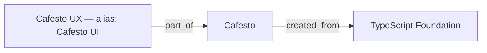

# Create and query Oracle RDF and SQL Property Graph

[English home](../../README.en.md) · [한국어](../guides/oracle-graph-examples.md)

Canonical relational records own identities, assertion versions, and source evidence. RDF represents those
facts with provenance. SQL Property Graph is a read projection used to find connected candidates; it is not
another independently edited copy of the knowledge base.

| Layer | Objects | Purpose |
|---|---|---|
| Canonical records | vk_g_entity, vk_g_claim, vk_g_version, vk_g_evidence | Identity, relationship versions, evidence |
| Native RDF | VK_FLOW_RDF network / VK_SHARED graph | Assertion-version RDF with quotes and temporal metadata |
| SQL Property Graph | VK_KG_ENTITIES, VK_KG_RELATIONS, VK_KNOWLEDGE_GRAPH | Traversal over relational views |
| Agent operations | vk_g_review, vk_g_identity, vk_g_operation | Review status, evidenced identifiers, change snapshots |

Relationship writes update relational records and RDF in the same application transaction. Property Graph
reads the views, so no separate copy/synchronization job is required. The service validates source freshness,
owner, scope, and time after retrieving graph candidates. RDF storage does not imply ontology inference;
arbitrary SPARQL and a general reasoning engine are not implemented.

## 1. Prepare application tables and RDF

Use a supported Oracle ADB, an application schema with required privileges, its Wallet, and `.env` settings.
Connect as the RDF network owner. Setup does not grant administrative rights or create a database.

```sh
./uvw run alembic upgrade head
./uvw run python -m scripts.prepare_knowledge_rdf
```

The RDF script checks the namespace, creates missing required graphs, and stops on a partially initialized
namespace rather than deleting it. Do not blindly rerun `setup_workflow_rdf` on an existing network.
Oracle DDL commits implicitly; inspect existing objects after any partial failure.

The following is an explanatory PL/SQL excerpt. Prefer the script above: it checks the account's default
tablespace rather than using the placeholder `APP_DATA`.

```sql
BEGIN
  SEM_APIS.CREATE_RDF_NETWORK(
    'APP_DATA', network_owner => USER, network_name => 'VK_FLOW_RDF');
  SEM_APIS.CREATE_RDF_GRAPH(
    'VK_SHARED', NULL, NULL,
    network_owner => USER, network_name => 'VK_FLOW_RDF');
END;
/
```

After success, set `WORKFLOW_RDF_ENABLED=true` and restart the services. Keep API and ingestion worker
running for the example to reach READY. Default v2 extraction uses `GRAPH_EXTRACTION_MODE=agent`.

## 2. Create SQL Property Graph

```sh
./uvw run python -m scripts.setup_property_graph
./uvw run python -m scripts.setup_property_graph --apply
```

The first command inspects version, privileges, and objects. `--apply` requires property-graph and view
creation privileges, creates/replaces the three project objects, and probes a GRAPH_TABLE query without
reading user data. It does not change source relationships. After success, set `PROPERTY_GRAPH_ENABLED=true`
and restart the API. When false, candidate traversal uses relational queries while RDF storage remains.

The essential DDL from [the setup script](../../scripts/setup_property_graph.py), after creating its views:

```sql
CREATE OR REPLACE PROPERTY GRAPH VK_KNOWLEDGE_GRAPH
  VERTEX TABLES (
    VK_KG_ENTITIES AS entities KEY (id)
      LABEL entity PROPERTIES (id, owner_id, scope, identity_key, label, kind)
  )
  EDGE TABLES (
    VK_KG_RELATIONS AS relations KEY (id)
      SOURCE KEY (subject_id) REFERENCES entities (id)
      DESTINATION KEY (object_id) REFERENCES entities (id)
      LABEL relation PROPERTIES
        (id, owner_id, scope, claim_id, predicate, status,
         temporal_kind, valid_from, valid_to, recorded_from, recorded_to)
  )
  OPTIONS (TRUSTED MODE);
```

## 3. Register an example with evidence

This is **fictional demonstration data**, not a statement about an actual Cafesto deployment.



Configure `KNOWLEDGE_API_URL` and `KNOWLEDGE_API_TOKEN` in `.env`, or use the local development
`API_PORT`/`DEV_API_TOKEN`. Do not paste credentials into documentation or commands.

```sh
./uvw run python -m scripts.demo_graph_relations          # no writes
./uvw run python -m scripts.demo_graph_relations --apply  # creates and queries demo data
```

The script stores one fictional source in `project:graph-demo`, waits for READY, begins review, creates
three entities and two relationships, binds an explicit alias, completes review, and queries both intents.
It prints source/revision/entity/assertion IDs and results. Unchanged reruns reuse stable identities and
idempotency keys. If someone modified or retracted the demo, inspect history instead of forcing a retry.
Demo data is not automatically deleted. This deterministic example does not benchmark Kev or LLM extraction.

A relationship body for `POST /api/v1/graph/assertions` or MCP `knowledge_graph_assert(assertion=...)`:

```json
{
  "scope":"project:graph-demo",
  "subject_id":"<UX entity UUID>",
  "predicate":"part_of",
  "object_id":"<Cafesto entity UUID>",
  "verified":true,
  "evidence":[{
    "knowledge_id":"<source UUID>",
    "revision_id":"<active revision UUID>",
    "quote":"Cafesto UX는 Cafesto의 일부다."
  }]
}
```

Replace UUID placeholders with script output. The quote remains Korean because it must exactly match the
example source; do not translate it when submitting evidence. The API writes both canonical records and
RDF. Direct application RDF INSERTs are unsupported because they bypass identity/evidence consistency.

## 4. Resolve identities and explore

Use `knowledge_graph_resolve(request={"query":"Cafesto UI","scopes":["project:graph-demo"]})` to inspect
the alias's current source evidence and entity ID. Exact matches are not semantic guarantees; ambiguous
results require review. Historical/stale/retracted bindings can be inspected with `knowledge_graph_bindings`
and `knowledge_graph_operation_history` before a versioned correction.

For source/evidence links, call `knowledge_graph_explore(request=...)` or `POST /api/v1/graph/explore`:

```json
{
  "intent":"evidence",
  "search":{"entity_ids":["<UX entity UUID>"],"scopes":["project:graph-demo"],"depth":2}
}
```

This follows `documents`, `part_of`, and `created_from` in both directions. Read exact evidence revisions
from the returned edges; the mode does not discover unrecorded relationships automatically.

For things to inspect when the foundation changes:

```json
{
  "intent":"dependencies",
  "search":{"entity_ids":["<Foundation entity UUID>"],"scopes":["project:graph-demo"],"depth":2}
}
```

This follows incoming `uses`, `depends_on`, `created_from`, `deployed_on`, and `part_of` links. An intent
sets direction/predicates; use `knowledge_graph_search` for custom combinations. Creation lineage does not
prove a current build dependency or automatic update propagation.

Inspect `paths`, `edges`, `evidence`, `truncated`, `candidate_backend`, and `storage`.
`oracle_property_graph` and `oracle_rdf` identify the Oracle paths. Time options include `valid_at`, `known_at`,
and `include_undated`. Unknown-date relations are excluded from explicit business-time queries by default.
A path suggests inspection targets, not confirmed impact; an empty graph does not prove no relation exists.

## 5. Inspect stored RDF

The RDF representation makes each assertion version a resource (`urn:vk:assertion:<version UUID>`) and
attaches subject_id, predicate, object_id, evidence and timestamps. It stores more than a bare triple.

For an application DB operator, bind an exact internal owner identifier and assertion version ID:

```sql
SELECT t.TRIPLE.GET_SUBJECT(USER, 'VK_FLOW_RDF') AS subject,
       t.TRIPLE.GET_PROPERTY(USER, 'VK_FLOW_RDF') AS predicate,
       t.TRIPLE.GET_OBJ_VALUE(USER, 'VK_FLOW_RDF') AS object_value
FROM "VK_FLOW_RDF#RDFT_VK_SHARED" t
WHERE t.TRIPLE.GET_MODEL(USER, 'VK_FLOW_RDF') =
      'VK_SHARED:<urn:vk:workflow:' || :owner_id || ':' || :version_id || '>';
```

`owner_id` is an internal service identifier, not an API token or database username. The result includes
`urn:vk:shared:predicate`, its `part_of` value, entity IRIs and evidence nodes. The `urn:vk:workflow:` named-graph
prefix is a shared implementation convention, not a restriction to workflow-only facts. This can read historical
versions; it is not a current-validity filter or a SPARQL inference example. End users should use authenticated APIs.

## 6. Query Property Graph candidates directly

```sql
SELECT version_id, source_id, target_id, relation_type
FROM GRAPH_TABLE (
  VK_KNOWLEDGE_GRAPH
  MATCH (s IS entity)-[e IS relation]->(t IS entity)
  WHERE e.owner_id = :owner_id
    AND s.owner_id = :owner_id AND t.owner_id = :owner_id
    AND e.status = 'ACTIVE' AND e.recorded_to IS NULL
  COLUMNS (e.id AS version_id, s.id AS source_id,
           t.id AS target_id, e.predicate AS relation_type)
)
WHERE target_id = :foundation_entity_id;
```

The example yields a Cafesto → Foundation candidate. This one-hop diagnostic query does **not** include
all source-freshness, scope and business-time checks used by the service. Do not expose the DB graph directly
to end users as a replacement for API authorization and evidence filtering.

## Review lifecycle and validation limits

`vk0010` adds per-source review state, evidenced identity bindings and append-only application snapshots.
New READY sources enter PENDING; older unreviewed active sources are discoverable too. An agent explicitly
records REVIEWING then COMPLETE/RELATIONS or COMPLETE/NONE after examining the whole source. Unresolved
work remains FAILED/UNRESOLVED. Kev skip and prepare alone do not complete review. Source updates create
new review work and make old-only identity evidence ineligible for confirmed matches.

Review completion is an agent attestation, not a semantic completeness guarantee. Interrupted work can be
explicitly reclaimed using the current version. History is retained; direct SQL changes to these new tables
are not covered by newly added audit triggers. Use API writes.

The fictional demo, repeated execution, identity conflicts/history and source revision behavior are tested
through the SQLite application API. Oracle migration DDL is compile-checked, not a substitute for executing
on a fresh ADB. The SQL above follows the checked-in setup/query implementation; verify actual privileges,
Oracle version and execution in your deployment. See [release validation](../reference/public-release-validation.md).
