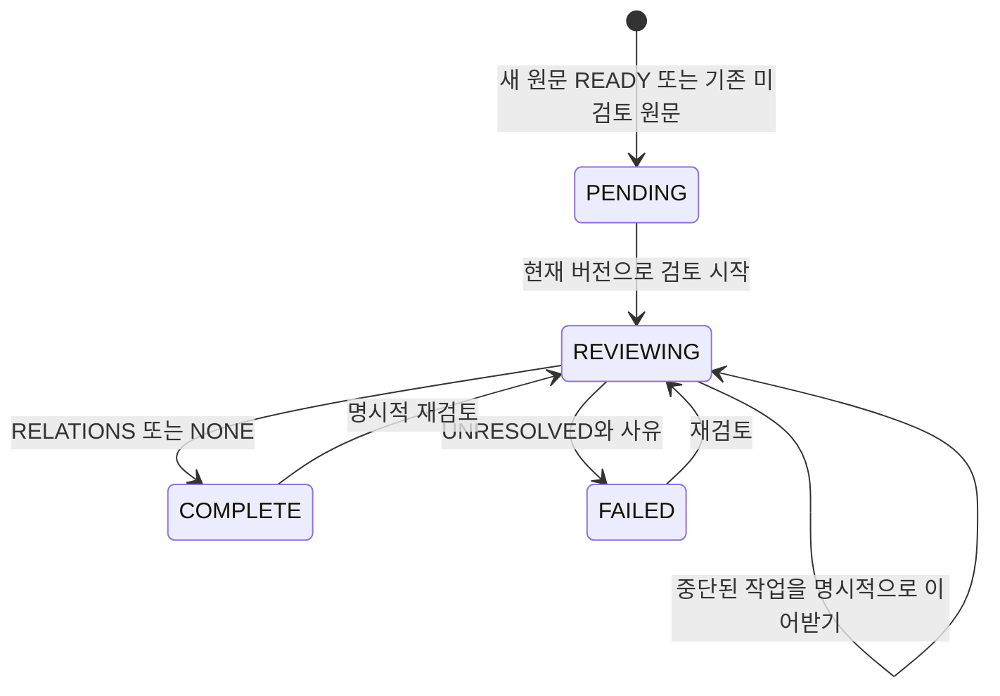

# 개체 식별과 이어받을 수 있는 관계 검토

이번 범위는 Kev 유지, 개체 식별 보강, RDF·SQL Property Graph의 활용 목적 구분이다.
Kev 비교 평가와 Oracle Text 도입은 포함하지 않는다. Oracle을 적극 활용하는 공개 프로젝트라는
목적도 유지한다. 상세 생성·조회 예제는 [Oracle 그래프 실습](oracle-graph-examples.md)을 따른다.

## 먼저 적용할 변경

API·MCP·임베딩 워커를 같은 소스로 업데이트한다. 백업 후 쓰기 작업을 중지하고 다음을 실행한다.

```sh
./uvw run alembic upgrade head
```

`vk0010`은 `vk_g_review`, `vk_g_identity`, `vk_g_operation` 테이블을 추가한다. 기존 개체·관계·
원문을 병합하거나 지우지 않는다. Oracle DDL은 자동 커밋되므로 일반 트랜잭션 롤백으로 되돌릴 수
없다. 기존 RDF/Property Graph를 재생성할 필요는 없다. 새 기능에는 `WORKFLOW_RDF_ENABLED=true`가
필요하다. 기존 사용자 스킬을 업데이트하고 MCP 연결도 새로 시작한다.

## 어떤 이름이 같은 대상인가

`knowledge_graph_resolve`는 다음 정보를 구분해 반환한다.

| 후보 | 의미 |
|---|---|
| canonical_key | 지정한 범위의 기존 identity_key와 정확히 일치 |
| evidenced_alias | 현재 원문의 정확한 인용으로 등록한 별칭 |
| evidenced_external | 현재 원문으로 확인한 저장소·서비스 등의 외부 식별자 |
| label_or_legacy_alias_hint | 이름·기존 별칭·키 일부의 일치. 동일성의 증거가 아님 |

확인된 프로젝트 범위와 global 안에서 조회하며, global 역시 같은 사용자의 개인 범위다.
exact는 문자열/등록 근거가 정확히 일치했다는 뜻이지 동일성의 자동 확정을 뜻하지 않는다.
`ambiguous=true`이면 복수 개체가 정확 후보이며, `truncated=true`이면 후보를 모두 본 것이 아니다.
프로젝트·운영/개발 환경은 scope, identity_key, 외부 식별자의 namespace/value에 명시한다.
별도 환경 컬럼이나 개체 벡터 유사도 검색은 이번 구현에 포함하지 않았다.

```json
{"query":"auth 서버","scopes":["project:my-app"],"namespace":"display-name"}
```

같은 이름이 다른 개체를 뜻할 수 있어 별칭은 여러 대상에 등록할 수 있다. 외부 식별자는
소유자·범위·namespace·정확한 value 조합에서 하나의 대상으로 관리한다. 외부 값의 대소문자와
URL 형식을 임의로 정규화하지 않는다. 저장 전에 실제 제공자의 식별 규칙을 확인한다.

`knowledge_graph_bind`에 entity_id, kind(alias/external), namespace, value, evidence와 note를
전달한다. 신규 expected_version은 0이다. value가 인용문에 있고 인용문이 활성 원문에 있는지
검사하지만, 두 표현이 실제로 같은 대상을 뜻하는지는 에이전트/사용자가 확인해야 한다.
자격증명·서명 URL을 식별자로 저장하지 않는다. 등록이 외부 URL 조회 권한을 뜻하지도 않는다.

정정 전 resolve 결과의 binding.id/version 또는 `knowledge_graph_bindings(entity_id=...)`에서
현재·철회·오래된 근거의 식별자 목록을 읽고 `knowledge_graph_operation_history`로
이력을 확인한다. 같은 외부 키의 대상을 바꿀 때 현재 expected_version과 새 근거·사유를 넣는다.
별칭 대상 변경은 기존 별칭 철회와 새 대상 등록으로 처리한다. 철회는 사용자 요청이 있을 때만
status=RETRACTED로 기록한다. 자동 병합·관계 이동·기존 개체 삭제는 수행하지 않는다.

원문 수정/은퇴 후에는 해당 이전 버전만 근거로 한 binding을 확정 후보에서 제외한다.
새 원문에 동일성이 유지되는지 확인한 뒤 최신 binding 버전과 새 evidence로 갱신한다.
과거 스냅샷은 삭제하지 않는다. 기존 label/aliases_json 기반 후보는 여전히 힌트로 나올 수 있다.
이 기능은 기존 그래프의 모든 이름 검색을 자동 대체하지 않는다. 에이전트는 resolve로 확인한
entity_id를 graph_search/explore에 전달한다. 웹에 별도의 식별자 편집 화면은 아직 없다.

## 새 지식과 기존 지식의 검토

원문이 READY로 활성화될 때 같은 트랜잭션에서 PENDING 검토 행을 만든다(그래프 기능 활성화 시).
기존 활성 원문 중 검토 행이 없는 항목도 backlog에 PENDING/version=0으로 보인다. 검토를
시작할 때 행을 생성하므로 대량 backfill을 미리 실행하지 않아도 이어받을 수 있다.



1. `knowledge_graph_reviews(scope="project:my-app")`로 미완료 항목을 페이지 단위로 확인한다.
2. `knowledge_graph_prepare`에서 정확한 원문 버전, 검토 상태와 Kev 조언을 받는다.
3. `knowledge_graph_review`에 revision_id, expected_version, status=REVIEWING, note를 보낸다.
4. 원문 전체를 읽고 resolve → 기존 관계 조회 → entity/assert/revise/bind를 수행한다.
5. 실제 관계와 근거가 저장됐으면 COMPLETE/RELATIONS, 전체를 검토했지만 관계가 없으면
   COMPLETE/NONE을 기록한다. 모호한 대상이 남으면 FAILED/UNRESOLVED와 사유를 기록한다.

서비스는 RELATIONS에 현재 원문의 활성 관계 근거가 있는지 확인하고, NONE인데 활성 근거가
있으면 거부한다. 모든 가능한 관계를 찾아냈다는 의미 검증은 하지 않는다. 완료는 에이전트의
검토 완료 선언이다. Kev skip, prepare 호출, 일부 관계 등록만으로 자동 완료 처리하지 않는다.

버전 충돌은 최신 상태를 읽고 조정한다. REVIEWING에는 자동 lease 만료나 강제 취소가 없다.
중단된 작업은 현재 version과 이어받는 사유로 REVIEWING을 갱신한다. 이전 에이전트의 완료
요청은 버전 충돌로 거절된다. 단, 별도 graph_assert까지 동일 lease로 묶지는 않으므로 같은
원문을 여러 에이전트가 동시에 편집하지 않는 것이 좋다.

원문이 바뀌면 새 revision에 새로운 PENDING이 생긴다. 이전 검토 이력은 보존되고 현재 backlog에서
제외된다. 은퇴 원문도 backlog에서 제외한다. 완료 후 그래프를 별도로 수정한 경우 자동으로 완료를
취소하지는 않으며 필요하면 명시적으로 재검토한다. 서비스 LLM의 기존 ExtractionRun과 이 검토
기록은 별개다. service 모드 작업 완료를 agent 검토 완료로 자동 간주하지 않는다.

## API와 이력

| 목적 | 경로 |
|---|---|
| 활성 원문 미완료 검토 목록 | GET /api/v1/graph/reviews?scope=project:my-app&offset=0&limit=30 |
| 검토 전이 | POST /api/v1/graph/reviews/{knowledge_id} |
| 개체 후보 | POST /api/v1/graph/identities/resolve |
| 근거 있는 식별자 등록/정정 | POST /api/v1/graph/identities |
| 개체의 식별자 목록(오래된 근거 포함) | GET /api/v1/graph/entities/{entity_id}/identities |
| 검토/식별자 스냅샷 이력 | GET /api/v1/graph/operations/{review_or_binding_id}?offset=0&limit=30 |
| 목적별 탐색 | POST /api/v1/graph/explore |

이력은 서비스가 같은 트랜잭션으로 append-only 스냅샷을 기록한다. 새 세 테이블에 대한 DB 직접
수정까지 추적하는 감사 트리거를 추가한 것은 아니다. DB 직접 수정은 이 계약을 우회하므로 지원
경로로 사용하지 않는다. 소유권·현재 원문·충돌 검증은 API에서 수행한다.
