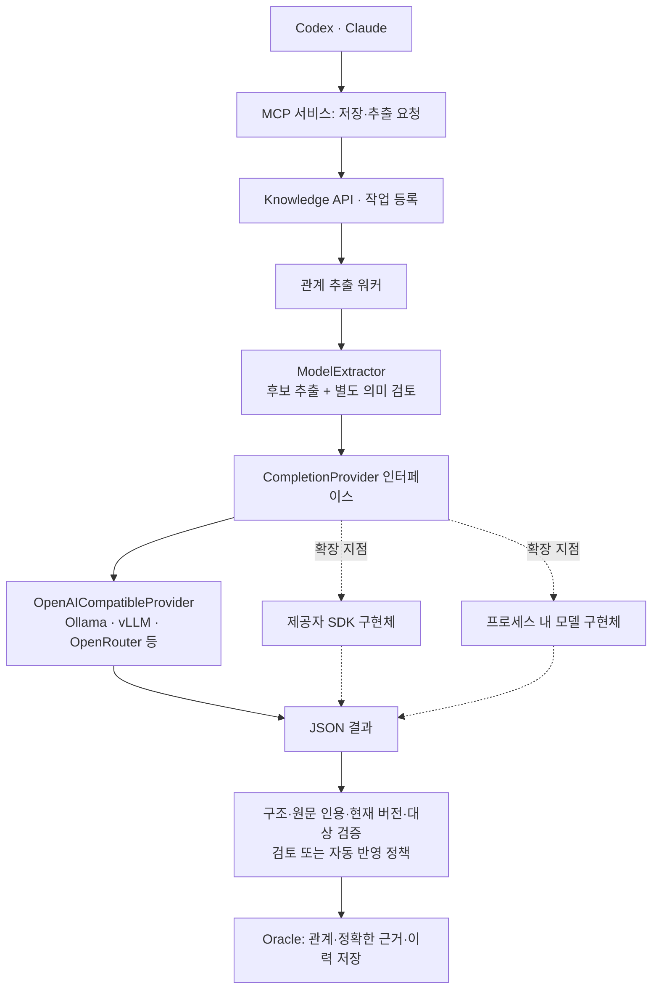

# MCP 서비스의 LLM 인터페이스

**자동 관계 추출을 위해 MCP 서비스에서 LLM을 호출한다.** Codex·Claude의 모델을 빌려 쓰거나
Oracle DB 내부에서 모델을 실행하는 방식이 아니다. 내부 실행 주체는 관계 추출 워커다.
호출된 LLM은 관계 후보를 반환하고, 서비스가 원문·개체·버전·정책을 검증한 뒤 DB에 저장한다.



## 구현 범위

| 연결 방식 | 현재 상태 |
|---|---|
| OpenAI 호환 HTTP API | 구현됨. Ollama·vLLM·OpenRouter 등 호환 endpoint 연결 |
| 제공자 SDK 직접 호출 | 인터페이스 주입 가능. OCI 등의 실제 SDK 어댑터는 아직 미구현 |
| Python 프로세스 내 모델 직접 실행 | 인터페이스 주입 가능. 실제 모델 로더·추론 어댑터는 아직 미구현 |

로컬 Ollama도 연결 방식은 HTTP API다. `openai_compatible`은 요청 형식 이름이며 OpenAI 유료
서비스를 반드시 쓴다는 뜻이 아니다. SDK/직접 실행을 `.env` 값만 바꿔 사용할 수 있다고
해석하면 안 된다. 해당 어댑터 구현과 의존성·실환경 검증이 필요하다.

## HTTP API 설정

```dotenv
GRAPH_AUTO_ENABLED=true
GRAPH_AUTO_PROVIDER=openai_compatible
GRAPH_AUTO_URL=http://127.0.0.1:11434/v1
GRAPH_AUTO_MODEL=adb-agent-knowledge-gemma4:e2b
GRAPH_AUTO_API_KEY=
GRAPH_AUTO_ALLOW_REMOTE=false
GRAPH_AUTO_STRUCTURED_OUTPUT=true
GRAPH_AUTO_POLICY=review
```

이 예시의 모델은 Ollama에 먼저 생성해야 하는 로컬 별칭이다. 실제 제공자의 모델 ID로
교체할 수 있다. 원격 HTTPS endpoint는 `GRAPH_AUTO_ALLOW_REMOTE=true`와 필요한 API 키를
설정한다. 기존 `.env`에서 PROVIDER를 생략해도 현재 HTTP 방식으로 동작한다.
설정한 모델/서버가 서비스에서 접근 가능해야 한다. 에이전트의 구독·API 키가 자동 공유되지 않는다.

HTTP 어댑터는 `/chat/completions`, 인증, JSON/JSON Schema 응답 형식, timeout, 응답 크기 제한,
출력 잘림 검사와 안전한 오류 변환을 담당한다. OpenRouter용 요청 옵션은 해당 어댑터 내부에만
남겨 다른 제공자 호출에 섞이지 않게 한다. 다른 모델로 조용히 대체하지 않는다.

## 개발자가 구현할 계약

[llm.py](../../knowledge_app/llm.py)의 계약은 다음과 같다.

```python
class CompletionProvider(Protocol):
    def complete(
        self, request: CompletionRequest
    ) -> str: ...  # 완전한 JSON 문자열 반환, 실패는 CompletionError
```

`CompletionRequest`에는 `model`, `system`, `user`, `json_schema`, `max_output_tokens`,
`timeout_seconds`가 있다. 구현체는 이를 자신의 SDK 또는 모델 runtime 형식으로 변환한다.
완전한 JSON을 반환하고 timeout·출력 제한을 지켜야 한다. API 키·원문·응답 본문을 오류 메시지에
노출하지 않는다. 원격 호출 구현은 해당 제공자의 endpoint·권한·데이터 전송 허용을 별도로 검증한다.
DB 저장과 자동 승인 여부는 구현체의 책임이 아니다.

이미 구현한 `provider` 인스턴스는 다음처럼 주입한다.

```python
extractor = ModelExtractor(settings, provider=provider)
# 또는 서비스 조립 지점에서 직접 주입
service = AutoGraphService(session_factory, app_settings, config=settings, completion_provider=provider)
```

위 코드는 주입 위치를 보여주는 예이며 OCI/Gemma용 완성된 SDK 구현은 아니다.
에이전트의 사용자 메시지나 `.env`에서 임의 Python 모듈을 동적으로 import하지 않는다.
상시 워커에서 설정으로 선택하려면 다음 변경을 함께 한다.

1. `CompletionProvider` 구현과 해당 제공자의 실제 호출·오류·timeout 테스트 추가.
2. `AutoGraphSettings.provider`의 허용 값·제공자별 설정 검증 확장.
3. `create_completion_provider(settings)`의 명시적 분기에 구현체 등록.
4. 필요한 의존성을 `pyproject.toml`·`uv.lock`에 고정하고 API/워커를 같은 버전으로 배포.

추출 prompt, 정확한 인용 규칙, 의미 검토와 publication 정책은 재작성하지 않는다.
`HTTPExtractor`는 기존 내부 호출 코드의 호환 이름으로 남으며 새 코드는 `ModelExtractor`를 쓴다.

## Kev·임베딩과의 구분

이 인터페이스는 관계 추출·의미 검토용 생성 모델에 적용한다. Kev의 판단 인터페이스와 임베딩
인터페이스는 별도다. Kev는 추출 필요성을 판단하고 임베딩 모델은 벡터를 만든다.
Codex·Claude는 검색된 근거를 바탕으로 최종 답변을 작성한다.

## 검증

주입한 in-process 테스트 제공자로 HTTP 없이 추출과 별도 의미 검토를 수행하는지 확인했다.
HTTP payload·인증·원격 opt-in·구조화 응답·과대 응답·출력 잘림·오류 비밀값 제거를 검증했다.
이 테스트는 실제 OCI SDK나 로컬 모델 가중치를 실행한 검증이 아니다. 운영 서버는 코드 공개만으로
변경되지 않으며 별도 배포가 필요하다.
