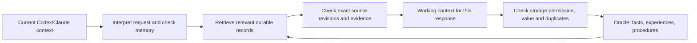

# Short- and long-term memory: what this project uses and why

[한국어](memory-types.md) · Reviewed 2026-11-22 against the integration for `oracleagentmemory==26.8.0`

**Oracle Agent Memory mainly provides long-term storage and retrieval here. Codex/Claude manage the active conversation; this application does not use SDK short-term conversation summaries or context cards.**

## Version and configuration boundary

This guide targets the 2026-11-22 hotfix after public `v0.3.0-alpha.1`; current development code is on `main`: package version `0.3.0a1`, source API version `0.3.0-alpha.1`, and locked Agent Memory dependency `26.8.0`. Cloning the release tag alone does not include later hotfix documentation/UI changes.

Fresh-install defaults are `KNOWLEDGE_SOURCE_BACKEND=legacy` and `AGENT_MEMORY_ENABLED=false`. SDK durable-memory paths require SDK installation, store initialization and explicit enablement; business-knowledge SDK primary content/search requires `KNOWLEDGE_SOURCE_BACKEND=v3`. Supported roles do not mean every path is enabled by default.

The remote configuration checked on 2026-11-22 enabled v3 and agent memory with SDK 26.8.0. Its API reported `0.3.0`, a deployment-metadata difference from the alpha source version, not evidence of a stable release. See [audit scope/results](../reference/memory-documentation-audit-2026-11-22.md).

## How does this reduce loss of detail during a long session?

**When earlier conversation is summarized or leaves the active context, preserve important decisions, conditions and evidence outside the conversation so they can be retrieved later.** The goal is to reduce dependence on repeatedly summarized chat. A stored source revision remains independent of the current conversation summary.

For example, an earlier condition might require a compatibility check before deployment and rollback on failure. A later conversation summary could retain only “proceed with deployment.” A separate record containing the decision, rationale, exceptions, observed checks and original evidence gives the next session a way to recover that condition. This is an illustrative example, not a measured loss-rate result.

1. **Capture while the details are still available.** Record confirmed decisions and verified failures/fixes at the time they become useful. Waiting until after another summary or session change may leave omitted conditions unavailable.
2. **Select useful information without stripping meaningful detail.** Preserve the conclusion, rationale, applicability/exceptions, failed attempts and observed results, date, project scope and source location. The goal is not one-line compression, nor storing complete chats, hidden reasoning, unnecessary personal data or secrets.
3. **Retrieve into the current context when needed.** Use titles/body wording that future questions are likely to match, search the relevant scopes, and check exact source revisions, evidence and currency. Read the source for conditions missing from its summary. The hook helps avoid skipping memory checks; it does not guarantee retrieval of every relevant record.

The accurate promise is **“keep important information available to check again after it leaves the current context,” not “the agent can never forget anything once it is saved.”** This cannot automatically recover details lost before capture, information never stored or exceptions omitted from the record. Persistence, retrieval success and correct use of retrieved information are separate concerns.

Conceptual reference: [Oracle: Context Window vs Memory](https://blogs.oracle.com/developers/what-is-agent-memory-a-beginners-guide-for-ai-developers). The selective capture/retrieval path here follows the implementation and code evidence below.

## Two classification axes

Short/long term describes **how long information is needed**. Semantic/episodic/procedural describes **what it contains**. These are not five sibling storage tiers. Oracle 26.8 documents short- and long-term pillars, while Oracle's conceptual material describes working, semantic, episodic and procedural memory. The following mapping describes our application, not a claim that each concept has a matching SDK enum or table.

| Type | Content | Current implementation | Reason |
|---|---|---|---|
| Short-term / working | Current conversation and active task state | **Used by the host client.** The app does not ingest the whole transcript into the SDK or request SDK context cards. | Keep conversation management with the client rather than operating a duplicate thread/summary path. |
| Long-term / semantic | Facts, preferences and project knowledge | **Used.** Knowledge facts/preferences/decisions/documents and SDK `fact`/`preference` records are examples. | Recover useful facts and decisions in later sessions. |
| Long-term / episodic | What happened, attempts, failures and observed outcomes | **Used.** Knowledge `EPISODE` records or appropriate SDK `memory` content. This does not mean saving every conversation. | Reuse prior troubleshooting with its context and evidence. |
| Long-term / procedural | Methods, checklists and reusable guidance | **Stored and retrieved.** Knowledge `PROCEDURE` and SDK `guideline` content are examples. Retrieved text is reference material, not execution permission. | Recover established procedures while checking current conditions and authorization. |
| SDK short-term tools | Thread messages, summaries and context cards | **Not integrated.** Thread profiles exist, but there is no app message-ingestion/context-card path; app-created threads use `enable_context_summary=False`. | Profiles identify provenance; conversation management has not been moved into the SDK. |
| Semantic response cache | Reusing a previous answer for a similar question | **Not implemented.** Distinct from vector retrieval of memory evidence. | The product does not serve old answers as current answers through this mechanism. |

Short-term does not require RAM-only storage: the SDK can persist conversation state. Long-term does not imply permanent retention or verified truth. This app currently provides no SDK agent-memory deletion MCP tools, default memory TTL, automatic forgetting or memory-compaction policy. Explicit business-knowledge retirement/restoration is separate. Browser login expiry is unrelated to memory retention.

Conceptual references: [Oracle 26.8 overview](https://docs.oracle.com/en/database/oracle/agent-memory/26.8/guide/about.html), [Oracle's four memory types](https://blogs.oracle.com/developers/oracle-ai-agent-memory-a-governed-unified-memory-core-for-enterprise-ai-agents), [context cards](https://docs.oracle.com/en/database/oracle/agent-memory/26.8/guide/int-customize-context-card-content.html).

## Why this split was chosen

The goal is **recovering decisions, evidence and reusable fixes across sessions, machines and agents**, rather than operating another copy of the host conversation. Distinguish documented design decisions from interpretation of the current code.

| Choice | Rationale and required property | Evidence/status |
|---|---|---|
| Keep durable memory in Oracle | Retrieve through the same authenticated owner/project scope across clients; retain exact sources, history and evidence instead of duplicating memory bodies in local files. | Existing [flow](storage-retrieval-flow.md), [multi-machine guide](multi-machine-memory.md), [design 0034](../design/0034-agent-memory-integration/design.md). |
| Leave active context with Codex/Claude; do not integrate SDK summaries/cards | This app is a storage/retrieval service, not the host conversation runtime. Its current boundary avoids another message-management path for context the client already holds. | **Interpretation of the current responsibility boundary.** No decision based on a benchmark showing SDK short-term memory to be slow or inaccurate was found. |
| Select useful facts, experiences and procedures instead of saving all turns | Avoid persisting transient requests or unverified guesses as durable facts; supplement existing records while retaining evidence. Conversation archiving and durable knowledge capture have different purposes. | [Memory policy](../../skills/adb-agent-knowledge/SKILL.md), [design 0034](../design/0034-agent-memory-integration/design.md). |
| Use the calling agent's review in default agent mode; disable SDK automatic extraction | Reuse the active Codex/Claude model to review exact sources and existing evidence without requiring another generation-model deployment. Optional service mode is for unattended extraction. | Explicit direction in [v2 design 0028](../design/0028-agent-extraction-v2/design.md) and [design 0034](../design/0034-agent-memory-integration/design.md). SDK extraction and optional business-RDF service extraction are separate. |
| Let Kev route need/path; let the agent check source meaning | Narrow the candidate context before reading summaries, exact sources and evidence. Kev scores do not establish truth or grant storage permission. | [Navigation design](../design/0015-index-navigation/design.md), [model roles](local-models.md). No universal token/latency reduction is established. |
| Distinguish semantic, episodic and procedural content | Recover what is believed now, what happened during an attempt and how to act next without automatically promoting an unverified experience into a fact. | [Memory policy](../../skills/adb-agent-knowledge/SKILL.md) and the implemented `memory_kind` contract; not three separate SDK engines. |
| Reuse SDK infrastructure while retaining app-owned revisions/evidence | Reuse storage, chunks, vectors, profiles and memory links without losing public IDs, immutable revisions, ownership, audit, quotations and business RDF. | [v3 design 0044](../design/0044-v3-primary-store/design.md). Compatibility/rollback copies remain; reduced storage/write cost is not claimed. |
| Separate durable lifetime from thread provenance | A conversation identifies where a memory originated; cleaning up a conversation should not define useful knowledge's lifetime. | Explicit in [design 0034](../design/0034-agent-memory-integration/design.md); `origin_thread_id` is the implementation. |
| Keep approved principles separate from retrieval | Required approved configuration must not disappear because of top-k ranking or Kev skip. Retrieved guidance is not automatically promoted into approved behavior. | [Principles design 0039](../design/0039-user-principles/design.md), [hook design 0038](../design/0038-required-memory-hook/design.md). |

The trade-off is that the app does not provide SDK conversation recovery or automatic compaction, and does not guarantee complete capture or correct retrieval. A future short-term integration needs separate design and validation; this documentation change does not enable one.

## How a request uses memory

- The installed hook can read up to two recent user/final-response messages, capped at 1,200 characters in total, from the same host transcript. Tool output and reasoning are excluded. Path/sensitive-content checks may omit this context. This is a bounded query-routing aid, **not SDK thread storage or summarization**.
- `knowledge_recall` retrieves business knowledge and enabled SDK agent memories. Placing selected sources into the prompt makes durable evidence available to the current task; it does not change the stored record into a short-term record.
- The hook does not save. The calling agent checks user storage authorization, evidence and duplicates before writing through MCP. In default agent mode, the agent performs semantic review; Kev assists with need/path selection.
- SDK automatic conversation extraction is disabled with `extract_memories=False`; `memory_save` uses `autonomous_linking=False`. These are separate from the application's business RDF extraction/review features.
- Turning an experience into a supported fact or reusable procedure requires deliberate evidence/history review and a new record or revision. No automatic promotion/consolidation pipeline is claimed.

## Distinguish thread, store and record type

### A thread profile does not mean SDK short-term memory is integrated

Profiles identify a conversation and its display name. Durable memories keep `origin_thread_id` in metadata rather than binding their lifetime to SDK `thread_id`. Conversation provenance filters retrieval; it does not set retention. This does not guarantee preservation against every SDK-level user/agent cascade or external deletion. The app does not expose general deletion MCP tools.

### Both business knowledge and agent memories can be long-term

v3 business sources use a separate `KNOWLEDGE_V3_STORE_ID` (default `AKKNOWLEDGEV3`) for JSON content, chunks and vectors. The application retains immutable revisions, exact citations, ownership/scope, audit and business RDF. Documents can serve semantic memory; incident records can serve episodic memory.

`AGENT_MEMORY_STORE_ID` (default `AKMEMORY`) uses SDK memory/profile/search APIs for experiences, preferences and memory links. **These stores do not represent short term versus long term.** Defaults are installation settings, not proof that a particular deployment has enabled either path.

| Classification | App values | Meaning |
|---|---|---|
| Business `memory_kind` | `DOCUMENT`, `DECISION`, `PREFERENCE`, `FACT`, `PROCEDURE`, `EPISODE` | Application document/experience categories. |
| SDK `memory_type` exposed here | `memory`, `fact`, `preference`, `guideline` | Public adapter record types; no additional `episodic`, `semantic` or `procedural` enum is implemented. |
| Ownership/context | Authenticated owner, `scope`, `agent_id`, `origin_thread_id` | Limits whose/contextual records are retrieved, not their short/long-term nature. |
| Semantic retrieval | Embedding-vector similarity | A **retrieval method**, distinct from semantic memory as a **content category**. Episodes and procedures can also be retrieved semantically. |

User principles have a procedural purpose but are separate **user-approved configuration** in this app. A retrieved procedure or guideline does not become an approved principle or an execution permission. See [user principles](user-principles.en.md).

## Code evidence and limits

- [Bounded host context](../../scripts/hook_context.py), [read-only prompt hook](../../scripts/memory_prompt_hook.py).
- [SDK extraction disabled](../../knowledge_app/agent_memory_repository.py), [thread summaries disabled; durable save/provenance](../../knowledge_app/agent_memory_service.py).
- [Adapter record types](../../knowledge_app/agent_memory_contracts.py), [business categories](../../knowledge_app/contracts.py), [approved configuration](../../knowledge_app/principles.py).
- [v3 storage](v3-primary-store.en.md), [storage trade-offs](storage-backends.en.md), [agent-memory integration](agent-memory.en.md).

This is a documentation/code review against Oracle 26.8 references. It does not enable new short-term features or report new live performance, automatic-forgetting or conversation-compaction tests.
