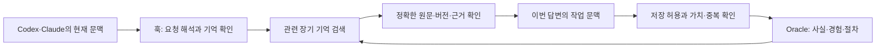

# 단기·장기 기억: 이 프로젝트가 사용하는 범위와 이유

[English](memory-types.en.md) · 확인일 2026-11-22 · `oracleagentmemory==26.8.0` 연결 코드 기준

**이 프로젝트는 Oracle Agent Memory를 주로 장기 기억 저장·검색에 사용합니다. 현재 대화의 단기 문맥은 Codex·Claude가 관리하며, SDK의 단기 대화 요약·컨텍스트 카드 기능은 연결하지 않았습니다.**

## 적용 버전과 기본 설정

이 설명의 코드 기준은 공개 `v0.3.0-alpha.1` 이후의 2026-11-22 hotfix입니다. 최신 개발 코드는 `main`에서 확인합니다. 패키지 버전은 `0.3.0a1`, 소스 API 표기는 `0.3.0-alpha.1`, Agent Memory 의존성은 `26.8.0`으로 잠겨 있습니다. `v0.3.0-alpha.1` 태그를 받는 것만으로 후속 hotfix 문서·UI 변경까지 포함되지는 않습니다.

새 설치의 기본은 `KNOWLEDGE_SOURCE_BACKEND=legacy`, `AGENT_MEMORY_ENABLED=false`입니다. 아래 SDK 장기 기억 경로는 SDK 설치·저장소 초기화·명시적 활성화가 필요하고, 업무 지식의 SDK 주 저장·검색은 `KNOWLEDGE_SOURCE_BACKEND=v3`일 때 적용됩니다. 따라서 ‘지원하는 기억 구조’와 ‘새 설치에서 모두 켜져 있음’은 다릅니다.

2026-11-22 점검 대상 원격 설정은 v3·에이전트 기억 활성, SDK 26.8.0이었습니다. 원격 API는 버전을 `0.3.0`으로 응답했지만 소스의 알파 표기와 다른 배포 메타데이터이며 정식 릴리스 증거가 아닙니다. [대조 결과·범위](../reference/memory-documentation-audit-2026-11-22.md).

## 긴 세션에서 중요한 내용이 희석되는 문제를 어떻게 줄이나요?

**대화가 길어져 앞선 내용이 요약되거나 현재 문맥에서 빠지더라도, 필요한 결정·조건·근거를 대화 밖에 따로 보관하고 나중에 다시 찾기 위한 구조입니다.** 같은 내용을 반복 요약한 대화만으로 작업을 이어가는 의존을 줄이는 것이 목적입니다. 저장된 원문 버전은 현재 대화의 요약과 독립적으로 남습니다.

예를 들어 처음에 정한 ‘배포 전에는 호환성 검사를 통과해야 하며, 실패하면 이전 버전으로 복구한다’는 조건이 긴 대화 요약에서 단순히 ‘배포 진행’으로 줄어들 수 있습니다. 중요한 결정을 별도 기록으로 남길 때 이유·예외·검증 결과와 원문 근거를 함께 보존하면, 다음 세션에서 배포 기록을 찾아 해당 조건을 다시 확인할 수 있습니다. 이 사례는 동작을 설명하기 위한 예시이며 실제 유실률을 측정한 결과는 아닙니다.

1. **세부 내용이 남아 있을 때 저장합니다.** 결정이 확정되거나 실패 원인·해결 결과를 검증한 시점에 기록합니다. 새 세션으로 옮기거나 대화가 더 요약된 뒤에만 정리하려 하면 이미 빠진 조건을 복원하지 못할 수 있습니다.
2. **필요한 내용을 선별하되 의미를 바꾸는 세부는 남깁니다.** 결론뿐 아니라 선택 이유, 적용 조건·예외, 실패한 시도와 관측 결과, 날짜·프로젝트 범위·원문 위치를 함께 적습니다. 짧은 한 줄로 압축하는 것이 목표는 아닙니다. 대화 전체·추론 과정·불필요한 개인정보·비밀정보를 저장하는 방식도 아닙니다.
3. **필요할 때 찾아 현재 문맥에 넣습니다.** 나중에 물을 법한 말로 제목·본문을 작성하고, 관련 범위에서 조회한 뒤 정확한 원문 버전·근거와 현재 유효성을 확인합니다. 요약에 없는 조건은 원문에서 읽습니다. 훅은 기억 확인 누락을 줄이지만 모든 관련 기록이 반드시 검색된다는 보장은 없습니다.

따라서 **‘한 번 저장하면 에이전트가 항상 잊지 않는다’가 아니라, ‘중요한 내용이 현재 문맥에서 빠져도 다시 확인할 수 있도록 보존한다’**가 정확합니다. 저장 전에 사라진 내용, 애초에 저장하지 않은 내용, 기록에서 빠뜨린 예외까지 자동으로 복구하지는 못합니다. 보존과 검색 성공, 검색된 내용을 올바르게 적용하는 것은 각각 확인해야 합니다.

개념 근거: [Oracle · Context Window vs Memory](https://blogs.oracle.com/developers/what-is-agent-memory-a-beginners-guide-for-ai-developers). 이 프로젝트의 선별 저장·조회 경로는 아래 구현 설명과 코드 근거를 따릅니다.

## 두 가지 분류 축

**단기·장기는 언제까지 필요한가**, **의미·일화·절차는 어떤 내용인가**의 구분입니다. 서로 같은 단계의 목록이 아닙니다.
Oracle 26.8 가이드는 단기·장기를 두 큰 범주로 설명하고, Oracle의 개념 자료는 작업·의미·일화·절차 기억을 구분합니다. 아래 표는 이 개념을 현재 앱에 대응한 설명이지 SDK에 같은 이름의 테이블이나 enum이 모두 있다는 뜻은 아닙니다.

| 구분 | 담는 내용 | 이 프로젝트의 사용 여부·구현 | 사용하는 이유 또는 미사용 이유 |
|---|---|---|---|
| 단기 / 작업 기억 (short-term / working) | 지금 진행하는 대화, 이번 작업의 상태, 당장 읽는 자료 | **클라이언트에서 사용.** Codex·Claude의 활성 문맥을 사용합니다. 앱은 SDK에 대화 전체를 적재하거나 SDK 컨텍스트 카드를 요청하지 않습니다. | 현재 작업의 문맥은 클라이언트가 이미 관리하므로 별도 대화 저장·요약 경로를 중복 운영하지 않습니다. |
| 장기 / 의미 기억 (long-term / semantic) | 확인한 사실, 프로젝트 지식, 사용자 선호 | **사용.** 업무 지식의 `FACT`, `PREFERENCE`, `DECISION`, 문서 등과 SDK 기억의 `fact`, `preference` 등에 담습니다. | 새 세션에서도 사실·선호·결정을 다시 찾아 반복 설명을 줄입니다. |
| 장기 / 일화 기억 (long-term / episodic) | 어떤 시도에서 무엇이 일어났고 어떻게 해결됐는지 | **사용.** 업무 지식의 `EPISODE`, 또는 내용에 맞는 SDK `memory` 기록으로 보존합니다. 모든 대화 원문을 저장하는 방식은 아닙니다. | 이전 실패·검증·해결 경위를 근거와 함께 재사용합니다. |
| 장기 / 절차 기억 (long-term / procedural) | 작업 방법, 확인 순서, 재사용할 지침 | **저장·조회에 사용.** 업무 지식의 `PROCEDURE`, SDK `guideline` 등이 대응합니다. 검색된 절차는 참고 자료이며 자동 실행·승인 지시가 아닙니다. | 검증한 작업 방법을 다시 찾되, 실행 권한과 현재 조건은 별도로 확인합니다. |
| SDK 단기 기억 도구 | thread 메시지, 대화 요약, 컨텍스트 카드 | **현재 미사용.** thread 프로필은 있지만 메시지 적재·컨텍스트 카드 API 경로는 없고, 앱이 생성하는 thread는 `enable_context_summary=False`입니다. | 프로필과 출처 식별만 필요하며 대화 관리까지 SDK로 이전하지 않았습니다. |
| 의미 기반 응답 캐시 (semantic cache) | 비슷한 질문에 과거 답변을 재사용 | **현재 미구현.** 벡터로 기억을 찾는 검색과 구분합니다. | 조회한 과거 답변을 현재 답변으로 그대로 반환하는 제품 동작은 제공하지 않습니다. |

단기라는 말은 반드시 RAM에만 있다는 뜻이 아니고, 장기라는 말도 영구 보존·자동 사실 검증을 뜻하지 않습니다. SDK는 단기 대화 상태도 DB에 보관할 수 있습니다. SDK 에이전트 기억의 삭제 MCP·기본 TTL·자동 망각/압축 정책은 현재 제공하지 않습니다. 업무 지식의 명시적 폐기·복원과는 별개입니다. 브라우저 로그인 유효기간은 기억의 보존기간과 별개입니다.

공식 개념 근거: [Oracle 26.8 · About Agent Memory](https://docs.oracle.com/en/database/oracle/agent-memory/26.8/guide/about.html), [Oracle · Four types of agent memory](https://blogs.oracle.com/developers/oracle-ai-agent-memory-a-governed-unified-memory-core-for-enterprise-ai-agents), [컨텍스트 카드](https://docs.oracle.com/en/database/oracle/agent-memory/26.8/guide/int-customize-context-card-content.html).

## 왜 이렇게 나눴나요?

목표는 **지금의 대화를 다른 곳에 한 번 더 저장하는 것보다, 세션·머신·에이전트가 바뀌어도 필요한 결정·근거·해결 방법을 다시 찾는 것**입니다. 아래는 과거 설계에 적힌 결정과 현재 코드의 역할 분담을 나눠 정리한 것입니다.

| 선택 | 이유와 유지하려는 성질 | 근거·확인 수준 |
|---|---|---|
| 장기 기억을 Oracle에 둠 | 클라이언트별 로컬 파일에 같은 본문을 복제하지 않고, 동일 인증 사용자와 프로젝트 범위로 다른 세션에서도 조회합니다. 정확한 원문·이력·근거를 남길 수 있어야 합니다. | 기존 [저장·조회 흐름](storage-retrieval-flow.md), [여러 머신 구성](multi-machine-memory.md), [통합 설계 0034](../design/0034-agent-memory-integration/design.md)의 목표입니다. |
| 단기 문맥은 Codex·Claude에 두고 SDK 요약·카드는 연결하지 않음 | 이 앱은 호스트 대화를 대신 운영하는 에이전트 런타임이 아니라 저장·검색 서비스입니다. 이미 호스트가 가진 단기 문맥을 SDK 메시지로 이중 관리하는 경로를 추가하지 않은 현재 책임 분담입니다. | **코드에 근거한 현재 구조의 설명**입니다. SDK 단기 기능이 느리거나 품질이 낮다는 실험을 근거로 배제한 결정은 확인하지 못했습니다. |
| 모든 대화 대신 가치 있는 사실·경험·절차를 선택적으로 저장 | 일시적인 요청과 미확인 추측을 장기 사실로 굳히지 않고, 기존 기록을 보완하며 무엇이 확인됐는지 남깁니다. 대화 원문 보관과 장기 지식 축적은 구분합니다. | [메모리 정책](../../skills/adb-agent-knowledge/SKILL.md), [통합 설계 0034](../design/0034-agent-memory-integration/design.md). |
| SDK 자동 추출 대신 기본 agent 모드의 Codex·Claude 검토 사용 | 이미 사용하는 에이전트가 원문·기존 지식·인용을 확인하게 하고, 별도 생성형 모델 설치·운영을 기본 요구사항에 추가하지 않습니다. 무인 처리가 필요할 때만 별도 service 모드를 선택합니다. | [v2 설계 0028](../design/0028-agent-extraction-v2/design.md)과 [통합 설계 0034](../design/0034-agent-memory-integration/design.md)에 명시된 방향입니다. SDK 자동 추출과 업무 RDF의 선택적 service 추출은 별개입니다. |
| Kev로 필요성·경로를 판단하고 원문 검증은 에이전트가 함 | 매번 모든 장기 기억을 문맥에 넣지 않고 관련 자료를 좁힌 뒤 요약→원문·근거 순서로 확인합니다. Kev 점수를 사실의 정답 확률이나 저장 허가로 사용하지 않습니다. | [인덱스 탐색 설계](../design/0015-index-navigation/design.md), [모델 역할](local-models.md). 토큰·지연 감소의 보편적 수치는 검증하지 않았습니다. |
| 의미·일화·절차를 구분해 남김 | ‘현재 무엇이 사실인가’, ‘무슨 시도를 해서 어떤 결과가 났는가’, ‘다음에 어떻게 해야 하는가’를 따로 찾을 수 있어야 합니다. 경험에서 얻은 가설을 검증된 사실로 자동 치환하지 않습니다. | [기억 정책](../../skills/adb-agent-knowledge/SKILL.md)과 실제 `memory_kind` 계약에 근거한 내용 분류입니다. SDK의 독립된 세 저장 엔진을 선택했다는 뜻은 아닙니다. |
| SDK의 공통 기능은 재사용하고 업무 버전·근거는 앱이 관리 | 저장·청크·벡터·프로필·기억 관계를 처음부터 다시 만들지 않으면서도, 기존 지식 ID·불변 버전·소유권·감사·정확 인용·RDF 계약을 유지해야 합니다. | [v3 설계 0044](../design/0044-v3-primary-store/design.md). 호환·복구 사본을 유지하므로 현재 저장·쓰기 비용이 줄었다고 주장하지 않습니다. |
| 장기 기억의 수명을 thread와 분리 | 대화는 ‘어디서 알게 됐는가’의 출처입니다. 대화 정리가 이후에도 필요한 지식의 수명까지 결정하지 않게 합니다. | [통합 설계 0034](../design/0034-agent-memory-integration/design.md)의 명시적 요구이며 `origin_thread_id`가 현재 구현입니다. |
| 사용자 원칙은 일반 검색과 분리 | 반드시 적용할 승인 설정이 검색의 top-k나 Kev skip에 따라 빠지지 않아야 합니다. 경험·절차 검색 결과를 승인된 행동 원칙으로 자동 승격하지 않습니다. | [원칙 설계 0039](../design/0039-user-principles/design.md), [필수 훅 설계 0038](../design/0038-required-memory-hook/design.md). |

이 선택에는 한계도 있습니다. 현재 앱만으로 SDK 단기 대화 복원·자동 압축을 제공하지 않으며, 장기 기억을 누락 없이 저장하거나 항상 맞는 자료를 검색한다는 보장도 없습니다. 필요하면 별도 단기 통합을 설계·검증할 수 있지만, 이 문서 보강으로 활성화되지는 않습니다.

## 현재 요청에서 실제로 이어지는 흐름

- 설치된 훅은 같은 세션의 최근 사용자·최종 답변을 최대 2개/총 1,200자만 읽어 후속 질문 해석에 사용합니다. 도구 출력·추론은 제외하며, 허용 경로·민감 입력 등의 조건을 만족하지 못하면 이 보조 문맥을 생략합니다. **Oracle SDK의 세션 저장·요약 기능이 아닙니다.**
- `knowledge_recall`은 업무 지식과 활성화된 SDK 기억을 조회합니다. 선택한 원문을 이번 프롬프트에 넣으면 장기 기록을 현재 작업 문맥에서 사용하는 것이며, 저장된 기록이 단기 레코드로 바뀌는 것은 아닙니다.
- 훅 자체는 저장하지 않습니다. 새 사실·경험·절차는 에이전트가 사용자 저장 허용, 정확한 근거와 중복을 확인한 뒤 MCP로 저장합니다. 기본 agent 모드의 판단·의미 검토는 에이전트가 맡으며 Kev는 필요성·경로 판단을 보조합니다.
- SDK 대화→기억 자동 추출은 `extract_memories=False`, `memory_save`의 자동 기억 연결은 `autonomous_linking=False`입니다. 이 설정을 앱의 별도 업무 RDF 추출·검토 기능과 혼동하지 마세요.
- 경험 기록을 검증된 사실·재사용 절차로 보완할 수 있지만, 자동 승격·자동 통합 파이프라인은 아닙니다. 기존 원문·이력과 모순 여부를 확인하고 새 기록이나 버전으로 의도적으로 반영해야 합니다.

## 세션·저장소·유형에서 혼동하기 쉬운 것

### thread는 단기 기억의 사용 증거가 아닙니다

현재 thread 프로필은 대화의 이름과 출처를 식별합니다. 장기 기억을 저장할 때 `origin_thread_id`를 metadata에 남기고 SDK `thread_id`로 수명을 묶지 않습니다. 대화 출처는 조회 조건일 뿐 보존기간을 결정하지 않습니다. 다만 SDK의 사용자·에이전트 삭제 등 모든 외부 삭제 경로로부터 보존을 보장하는 것은 아닙니다. 앱은 범용 삭제 MCP를 제공하지 않습니다.

### 업무 지식과 에이전트 메모리는 모두 장기 기억을 담을 수 있습니다

v3 업무 지식은 별도 `KNOWLEDGE_V3_STORE_ID`(기본 `AKKNOWLEDGEV3`)에 원문 JSON·청크·벡터를 둡니다. 기존 앱이 불변 원문 버전, 정확한 인용, 범위·소유권·감사와 업무 RDF를 관리합니다. 문서도 장기 의미 기억, 장애 검증 기록도 장기 일화 기억으로 사용할 수 있습니다.

별도 `AGENT_MEMORY_STORE_ID`(기본 `AKMEMORY`)는 에이전트 경험·선호·기억 관계를 위해 SDK 저장·검색·프로필 API를 사용합니다. **두 저장소가 각각 단기/장기를 의미하는 것은 아닙니다.** 기본값은 설치 값이며 이 문서가 특정 실행 환경의 활성화를 증명하지는 않습니다.

### 기억의 뜻과 API 분류값은 일대일로 같지 않습니다

| 구분 | 실제 앱의 값 | 해석 |
|---|---|---|
| 업무 지식 `memory_kind` | `DOCUMENT`, `DECISION`, `PREFERENCE`, `FACT`, `PROCEDURE`, `EPISODE` | 앱의 문서·경험 분류입니다. |
| SDK 기억 `memory_type` | `memory`, `fact`, `preference`, `guideline` | 이 앱이 공개하는 SDK 기록 종류입니다. 별도 `episodic`·`semantic`·`procedural` enum을 추가한 것은 아닙니다. |
| 프로젝트·사용자·에이전트·대화 범위 | `scope`, 인증 소유자, `agent_id`, `origin_thread_id` | 누구의 어떤 맥락인가를 제한하며, 그 자체가 단기/장기를 결정하지 않습니다. |
| 의미 검색 | 임베딩 벡터의 유사도 | 기억을 **찾는 방법**입니다. 일화·절차도 의미 검색할 수 있으며 의미 기억이라는 **내용 종류**와 다릅니다. |

사용자 원칙은 행동을 안내한다는 점에서 절차적 성격이 있지만, 이 앱에서는 별도의 **승인된 설정**입니다. 검색된 `PROCEDURE`나 `guideline`이 자동으로 사용자 원칙이나 실행 권한이 되지 않습니다. [사용자 원칙](user-principles.md)을 참고하세요.

## 코드 근거와 검증 한계

- [현재 대화의 제한된 보조 문맥](../../scripts/hook_context.py), [조회만 수행하는 훅](../../scripts/memory_prompt_hook.py).
- [SDK 연결·자동 추출 비활성](../../knowledge_app/agent_memory_repository.py), [thread 요약 비활성·장기 기억 저장·출처](../../knowledge_app/agent_memory_service.py).
- [공개 SDK 기억 종류](../../knowledge_app/agent_memory_contracts.py), [업무 지식 종류](../../knowledge_app/contracts.py), [승인 설정 분리](../../knowledge_app/principles.py).
- [v3 저장 계층](v3-primary-store.md), [저장소 선택 이유](storage-backends.md), [에이전트 메모리 연결](agent-memory.md).

이 설명은 확인한 코드와 Oracle 26.8 공식 자료를 대조한 문서 보강입니다. 신규 단기 기억 기능을 구현하거나 활성화한 것이 아니며, 새 운영 성능·자동 망각·대화 압축 시험을 수행한 결과도 아닙니다.
