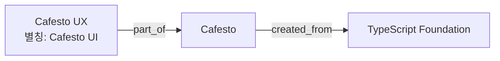

# Oracle RDF·SQL Property Graph 생성과 조회 실습

이 프로젝트의 원칙은 **관계 테이블에 식별·버전·시점 기준을 두고, RDF에는 근거를 포함한 사실을
표현하고, SQL Property Graph로 연결 후보를 탐색**하는 것이다. 두 엔진이 별도로 관계를 추측하거나
동일 개체를 자동 병합하지 않는다.

| 계층 | 객체 | 역할 |
|---|---|---|
| 기준 데이터 | vk_g_entity / vk_g_claim / vk_g_version / vk_g_evidence | 개체·관계 버전·근거 |
| RDF | VK_FLOW_RDF 네트워크, VK_SHARED 그래프 | 관계 버전과 인용·시점을 포함한 RDF 표현/검증 |
| Property Graph | VK_KG_ENTITIES / VK_KG_RELATIONS / VK_KNOWLEDGE_GRAPH | 기준 테이블 View를 통한 연결 후보 탐색 |
| 에이전트 작업 | vk_g_review / vk_g_identity / vk_g_operation | 원문 검토 상태·확인된 식별자·변경 이력 |

Property Graph는 데이터 복사본이 아니라 View 위의 읽기 투영이다. API로 관계를 생성/수정하면
관계 테이블과 RDF를 같은 트랜잭션으로 갱신하며, Property Graph는 테이블 변경을 바로 본다.
별도 주기 동기화 작업이 필요하지 않다. 그래프 후보를 얻은 뒤 서비스가 소유권·범위·시점·현재
원문 근거를 검사한다. RDF는 현재 자유 SPARQL/온톨로지 추론 엔진으로 사용하지 않는다.

## 1. 테이블과 RDF 초기화

지원되는 Oracle ADB와 앱 스키마, Wallet/.env, 필요한 권한을 먼저 준비한다. 실행 계정은 RDF
네트워크 소유자이며 전용 앱 테이블스페이스를 사용한다. 실제 지원·권한은 대상 ADB에서 확인한다.
DB 생성이나 관리자 권한 부여를 이 스크립트가 대신하지 않는다.

```sh
./uvw run alembic upgrade head
./uvw run python -m scripts.prepare_knowledge_rdf
```

두 번째 명령은 네임스페이스 상태를 확인하고 없을 때만 네트워크/그래프를 준비한다. 일부만 존재하면
삭제·재생성하지 않고 중단한다. 기존 환경에 setup_workflow_rdf를 무조건 재실행하지 않는다.
DDL은 자동 커밋되므로 실패 시 객체 상태를 확인한 뒤 이어간다.

실제로 사용하는 핵심 PL/SQL 형태는 다음과 같다. **설명용 발췌이며, 실제 실행은 위 스크립트를
권장한다.** `APP_DATA`는 예시 테이블스페이스명이다. 스크립트는 계정의 기본 테이블스페이스를 확인한다.

```sql
BEGIN
  SEM_APIS.CREATE_RDF_NETWORK(
    'APP_DATA', network_owner => USER, network_name => 'VK_FLOW_RDF');
  SEM_APIS.CREATE_RDF_GRAPH(
    'VK_SHARED', NULL, NULL,
    network_owner => USER, network_name => 'VK_FLOW_RDF');
END;
/
```

완료 후 `.env`에 `WORKFLOW_RDF_ENABLED=true`를 설정한다. 일반 원문·벡터 저장을 담당하는 API와
임베딩 워커를 실행해야 아래 데모의 READY까지 진행된다. v2는 `GRAPH_EXTRACTION_MODE=agent`를 사용한다.

## 2. SQL Property Graph 생성

```sh
./uvw run python -m scripts.setup_property_graph          # 버전·권한·객체 조회만
./uvw run python -m scripts.setup_property_graph --apply  # View/Graph 생성·재정의
```

`CREATE PROPERTY GRAPH`와 View 생성에 필요한 권한이 있어야 한다. `--apply`는 프로젝트가 소유한
위 세 객체를 CREATE OR REPLACE하며 기존 관계 행은 변경하지 않는다. 생성 후 GRAPH_TABLE 파싱·실행을
설치용 빈 식별자로 검증한다. 성공하면 `PROPERTY_GRAPH_ENABLED=true`로 설정하고 API를 재시작한다.
false이면 동일 API가 관계형 후보 탐색을 사용하며 RDF 저장은 그대로다.

[실제 DDL](../../scripts/setup_property_graph.py)의 핵심은 다음과 같다. View 생성은 스크립트에 포함돼 있다.

```sql
CREATE OR REPLACE PROPERTY GRAPH VK_KNOWLEDGE_GRAPH
  VERTEX TABLES (
    VK_KG_ENTITIES AS entities KEY (id)
      LABEL entity PROPERTIES (id, owner_id, scope, identity_key, label, kind)
  )
  EDGE TABLES (
    VK_KG_RELATIONS AS relations KEY (id)
      SOURCE KEY (subject_id) REFERENCES entities (id)
      DESTINATION KEY (object_id) REFERENCES entities (id)
      LABEL relation PROPERTIES
        (id, owner_id, scope, claim_id, predicate, status,
         temporal_kind, valid_from, valid_to, recorded_from, recorded_to)
  )
  OPTIONS (TRUSTED MODE);
```

## 3. Cafesto 예제 관계 만들기

다음은 **설명용 가상 데이터**이며 실제 Cafesto 프로젝트 상태를 주장하지 않는다.



실행 파일은 [demo_graph_relations.py](../../scripts/demo_graph_relations.py)다.
API 연결은 `.env`의 KNOWLEDGE_API_URL/KNOWLEDGE_API_TOKEN을 사용하며, 로컬 개발은
API_PORT/DEV_API_TOKEN을 사용할 수 있다. 원격 API 키를 명령줄·문서에 붙여 넣지 않는다.

```sh
./uvw run python -m scripts.demo_graph_relations          # 설명만, 쓰기 없음
./uvw run python -m scripts.demo_graph_relations --apply  # 실제 데모 데이터 등록/조회
```

`--apply`는 project:graph-demo에 원문 하나를 저장하고 READY를 확인한다. 원문 전체 확인 → REVIEWING
→ 개체 세 개 → 관계 두 개 → 근거 있는 별칭 → COMPLETE/RELATIONS → 목적별 조회 순서로 실행한다.
고정된 데모 저장 키와 개체 키를 재사용하므로 변경되지 않은 데모의 재실행은 중복 노트를 만들지 않는다.
사용자가 데모 원문/식별자를 수정·철회했다면 자동 덮어쓰기하지 않고 실패할 수 있으므로 이력을 확인한다.
테스트 데이터는 자동 삭제하지 않는다. 실행 결과에 knowledge_id, revision_id, 개체 ID, 관계 버전과
각 조회 결과를 출력한다. 소스의 사실이 이미 정해진 실습이므로 이 스크립트 자체가 Kev/LLM 추출 품질
평가를 하지는 않는다. 일반 에이전트 흐름에서는 prepare의 Kev 조언과 스킬을 따른다.

관계 등록 API의 핵심 body는 다음과 같다. `<...>`는 데모가 출력한 실제 UUID로 교체한다.

```json
{
  "scope":"project:graph-demo",
  "subject_id":"<UX entity UUID>",
  "predicate":"part_of",
  "object_id":"<Cafesto entity UUID>",
  "verified":true,
  "evidence":[{
    "knowledge_id":"<source UUID>",
    "revision_id":"<active revision UUID>",
    "quote":"Cafesto UX는 Cafesto의 일부다."
  }]
}
```

`POST /api/v1/graph/assertions` 또는 MCP `knowledge_graph_assert(assertion=...)`로 전달한다.
생성 시 API가 관계 테이블과 RDF를 기록한다. 애플리케이션용 관계를 RDF에 직접 INSERT하면
기준 테이블·근거 검증을 우회하므로 이 프로젝트에서는 지원하지 않는다.

## 4. 에이전트가 근거와 의존 경로 조회하기

`knowledge_graph_resolve(request={"query":"Cafesto UI","scopes":["project:graph-demo"]})`로
별칭의 현재 근거와 개체 ID를 확인한다. 이름이 비슷한 힌트와 exact 후보를 구분한다.

근거 연결: MCP `knowledge_graph_explore(request=...)` 또는 `POST /api/v1/graph/explore`:

```json
{
  "intent":"evidence",
  "search":{"entity_ids":["<UX entity UUID>"],"scopes":["project:graph-demo"],"depth":2}
}
```

이 모드는 documents/part_of/created_from 관계를 양방향으로 탐색한다. 결과의 evidence에서
원문·버전·인용을 얻고 원문을 읽는다. 관계가 없는 일반 문서의 근거를 대신 찾아주는 모드는 아니다.

의존 검토 대상: Foundation에서 **들어오는 연결**을 따라 Cafesto와 UX를 찾는다.

```json
{
  "intent":"dependencies",
  "search":{"entity_ids":["<Foundation entity UUID>"],"scopes":["project:graph-demo"],"depth":2}
}
```

이 모드는 incoming 방향의 uses/depends_on/created_from/deployed_on/part_of를 사용한다.
intent가 search의 direction/predicates를 지정하므로 자유 조합이 필요하면 기존 graph_search를 쓴다.
각 결과의 paths, edges, evidence, truncated, candidate_backend, storage를 확인한다.
`candidate_backend=oracle_property_graph`, `storage=oracle_rdf`이면 해당 Oracle 경로다.
연결은 변경 시 **확인할 후보**를 뜻하며 실제 장애·영향의 확정이 아니다. valid_at/known_at과
include_undated로 업무/기록 시점을 지정할 수 있고, 날짜를 모르는 관계는 명시적 날짜 검색에서
기본 제외된다. 경로에 없는 자료도 존재할 수 있으므로 빈 결과를 관계 부재의 증명으로 쓰지 않는다.

## 5. DB에서 실제 RDF 표현 확인

이 서비스는 단순 `(UX, part_of, Cafesto)`만 저장하지 않고 **관계 버전 자체를 RDF 자원으로 표현**한다.
예를 들어 `urn:vk:assertion:<version UUID>`에 subject_id, predicate, object_id, evidence,
recorded_from 등을 연결한다. 과거 근거와 시점을 보존하기 위한 형태다.

아래는 앱 DB 운영자가 정확한 owner_id와 assertion version_id를 바인딩해 읽는 진단 SQL이다.
owner_id는 API 토큰이나 사용자명 문자열이 아니라 서비스 내부 소유자 식별자다. 일반 사용자는
위 API를 쓰며 DB 전체 조회 권한을 받지 않는다. 이 쿼리는 역사 버전도 읽을 수 있어 현재 유효성
판정 대신 사용하지 않는다.

```sql
SELECT t.TRIPLE.GET_SUBJECT(USER, 'VK_FLOW_RDF') AS subject,
       t.TRIPLE.GET_PROPERTY(USER, 'VK_FLOW_RDF') AS predicate,
       t.TRIPLE.GET_OBJ_VALUE(USER, 'VK_FLOW_RDF') AS object_value
FROM "VK_FLOW_RDF#RDFT_VK_SHARED" t
WHERE t.TRIPLE.GET_MODEL(USER, 'VK_FLOW_RDF') =
      'VK_SHARED:<urn:vk:workflow:' || :owner_id || ':' || :version_id || '>';
```

예상 내용에는 `urn:vk:shared:predicate`의 `part_of` 값, 양 끝 개체 IRI와 evidence 노드가 포함된다.
`urn:vk:workflow:`는 현재 구현에서 공유하는 named-graph 식별 형식이며 관계가 업무 절차에만
한정된다는 뜻이 아니다. 이 SQL은 현재 코드의 RDF accessor 조회 방식이며 별도 SPARQL 추론 예제가 아니다.

## 6. DB에서 Property Graph 후보 조회

```sql
SELECT version_id, source_id, target_id, relation_type
FROM GRAPH_TABLE (
  VK_KNOWLEDGE_GRAPH
  MATCH (s IS entity)-[e IS relation]->(t IS entity)
  WHERE e.owner_id = :owner_id
    AND s.owner_id = :owner_id AND t.owner_id = :owner_id
    AND e.status = 'ACTIVE' AND e.recorded_to IS NULL
  COLUMNS (e.id AS version_id, s.id AS source_id,
           t.id AS target_id, e.predicate AS relation_type)
)
WHERE target_id = :foundation_entity_id;
```

예제 관계라면 Cafesto → Foundation의 created_from이 후보로 나온다. 이 SQL은 한 단계 후보 조회이며,
원문의 현재 유효성·scope·업무 시점을 모두 검사한 최종 결과는 아니다. 앱은 기준 테이블과 근거를
추가로 검증한다. 일반 사용에는 depth를 지정할 수 있는 위 API를 권장한다.

## 검증 범위

데모 재실행, 두 단계 경로, 별칭 해결, 원문 갱신에 따른 근거 무효화·이력은 SQLite 자동 테스트로
검증한다. 새 vk0010의 Oracle DDL은 컴파일 검증한다. 새 ADB 실행 검증과는 다르다.
실환경에서는 버전·권한·migration과 위 스크립트 실행 결과를 따로 확인해야 한다.
