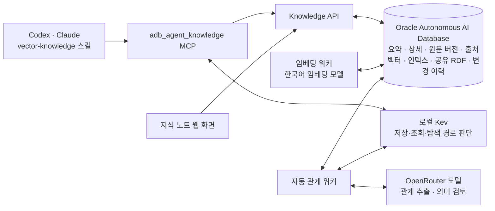
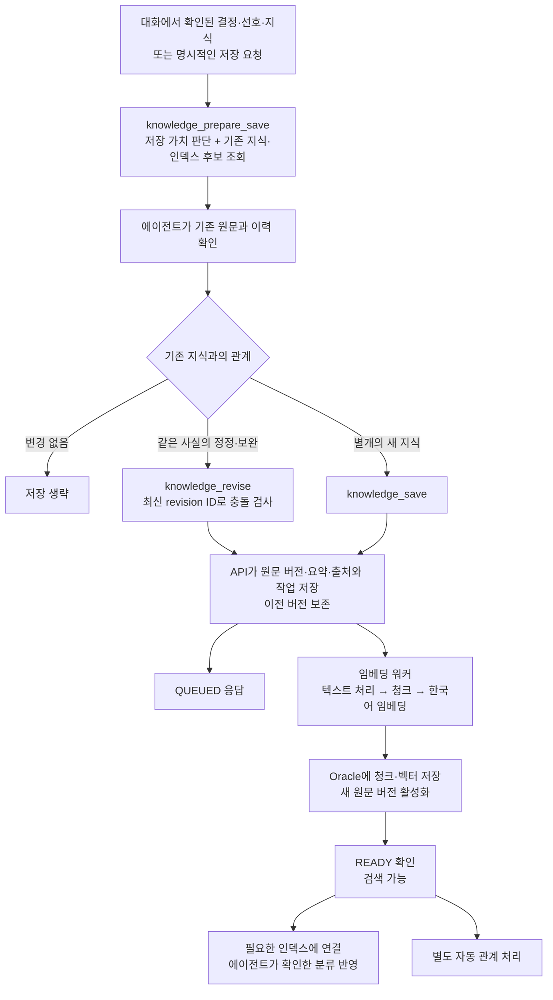
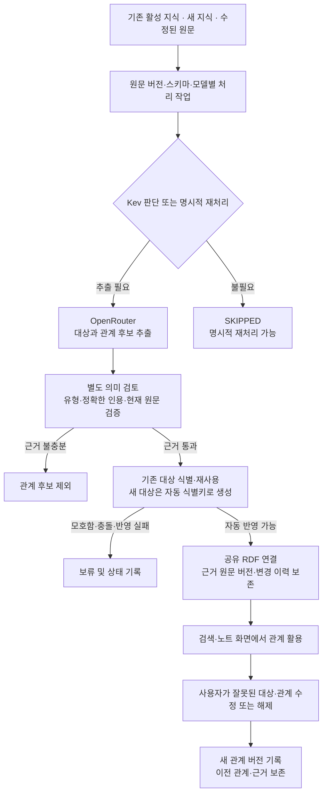
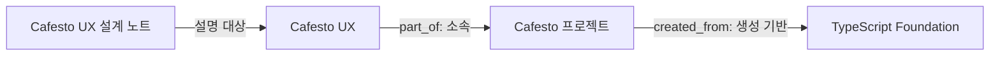
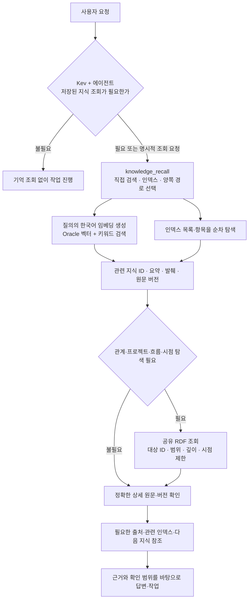

# Agent Knowledge for Oracle ADB 저장·조회 흐름

2026-10-19 현재 구현 기준. 에이전트의 저장·조회 판단, API의 실제 처리, 비동기 관계 연결을 구분한다.

## 구성

- **Oracle**이 지식과 이력의 기준 저장소다. 로컬 Markdown은 스킬 지침과 원본 설계 자료 등에 사용한다.
- **Kev**는 처리 필요성과 경로를 판단한다. 임베딩 생성, 관계 추출, 사실 확정은 담당하지 않는다.
- **한국어 임베딩 모델**은 로컬에서 실행한다. 현재 모델은 `dragonkue/snowflake-arctic-embed-l-v2.0-ko`다.
- **OpenRouter 모델**은 자동 관계 추출과 별도 의미 검토에 사용한다. 임베딩과는 다른 처리다.
- 웹 화면에서 직접 수행한 저장·조회는 Kev의 허가를 기다리지 않는다.

## 1. 저장과 기존 지식 보완

- `knowledge_prepare_save`는 준비 단계이며 지식을 직접 쓰지 않는다.
- 저장·수정 여부는 에이전트가 기존 원문을 확인해 결정한다. 서버가 유사한 문서를 임의로 합치지 않는다.
- 수정은 전체 상세 내용을 새 버전으로 저장한다. 최신 revision ID가 다르면 재확인이 필요하다.
- 저장 응답의 `QUEUED`와 실제 검색 가능한 `READY`를 구분한다. 실패한 작업은 원인을 확인한 뒤 재처리한다.
- 요약은 직접 제공할 수 있으며, 생략하면 발췌형 미리보기를 사용한다. 자동 생성 요약은 현재 구현 범위가 아니다.
- 출처에는 원본 위치·머신 ID·버전·문서 내 위치를 기록할 수 있다. 파일 경로 기록이 파일의 접근 가능성을 보장하지는 않는다.

## 2. 기존·신규 지식의 자동 관계 연결

현재 운영 정책은 `auto_verified`다. 의미 검토를 통과하고 대상 식별이 가능한 관계는 사용자의 개별 승인 없이 연결한다. 이는 자동 추론 결과이며 인간이 확인한 사실이라는 뜻은 아니다.

- 기존 지식도 처리 대상이다. 과거 작성자 감사 기록이 없는 경우 인증된 재처리 요청을 자동 반영의 실행 주체로 사용할 수 있다. 과거 작성자를 새로 추정하지 않는다.
- 관계 추출 완료와 RDF 연결 완료는 다르다. `DONE`/`PARTIAL`만으로 연결 성공을 단정하지 않고 자동 반영 결과를 확인한다.
- 관계를 여러 문서에서 뒷받침하면 동일 관계에 근거를 보완할 수 있다.
- 같은 이름만으로 대상을 병합하지 않는다. 모호한 대상은 보류한다.
- 사람이 수정한 관계와 같은 원래 후보는 동일 지식 항목에서 자동으로 재반영하지 않도록 보호한다. 표현이 달라진 후보까지 완전히 판별하는 것은 아니다.

예시 관계 구조이며, 아래 내용이 실제 저장됐다는 의미는 아니다.

`created_from`은 템플릿에서 시작했다는 생성 계보다. 현재 실행·빌드 의존인 `depends_on`이나 자동 업데이트 전파와는 다르다.

## 3. 지식 조회와 근거 확인

- 명시적인 조회 요청이나 꼭 필요한 과거 맥락은 Kev의 잘못된 건너뛰기 판단보다 우선한다.
- 인덱스 탐색은 벡터 검색의 상위 결과만으로 전체 범위를 알기 어려울 때 사용한다.
- 관계 조회는 `knowledge_graph_search`로 명시적으로 수행할 수 있다. MCP의 `knowledge_search(graph_mode=auto)`에도 Kev 판단에 따른 그래프 확장이 있다. 모든 검색이 자동으로 모든 경로를 수행하는 것은 아니다.
- RDF는 여러 노트·프로젝트에 걸친 공유 관계이며, 근거는 정확한 지식·원문 버전에 연결된다.
- `valid_at`은 관계가 적용되는 업무 시점, `known_at`은 당시 저장소가 알고 있던 기록 시점이다. 일반 벡터 검색 전체에 시간 필터가 적용된다는 의미는 아니다.
- 조회 시 소유자 권한을 적용하고 필요한 프로젝트 범위를 선택한다. `global`도 해당 사용자 안의 공통 범위다.
- 검색 점수와 모델 판단은 사실의 확률이 아니다. 요약과 검색 발췌만으로 결론을 내리지 않고 정확한 원문을 확인한다.

## 4. 웹 화면에서 조회

웹 화면은 API로 목록·검색·원문·그래프를 조회한다. **관계 있는 지식만**을 선택하면 현재 활성 원문을 근거로 하는 최신 활성 공유 RDF 관계가 있는 노트만 반환한다.

필터는 목록과 검색에 적용하며, 미승인 후보·해제된 관계·이전 원문만을 근거로 하는 관계는 제외한다. 관계가 여러 개여도 노트는 중복되지 않으며, 필터링 후 페이지를 나눈다. 인덱스 탐색으로 전환하면 이 필터는 해제된다.

## 관련 문서

- [자동 그래프 설정과 운영](automatic-graph.md)
- [공유 RDF와 시점 조회](shared-graph.md)
- [인덱스 탐색](index-navigation.md)
- [변경 이력](change-history.md)
- [Codex·Claude 설치](agent-installation.md)
