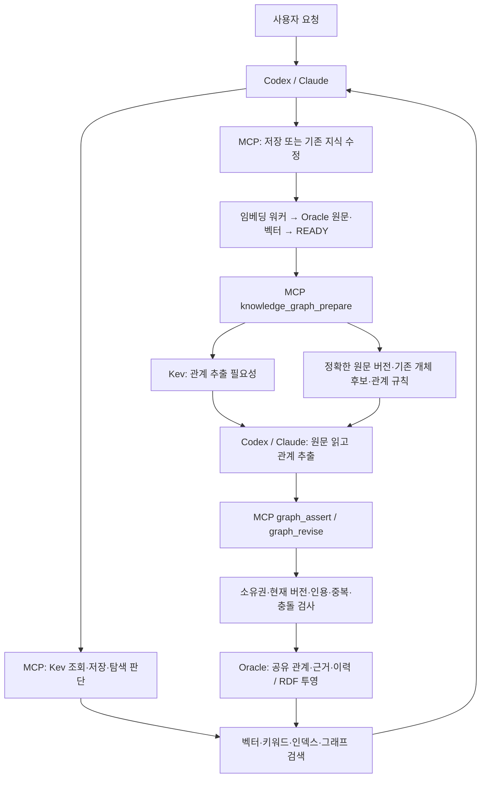

# v2: 에이전트가 추출하고 MCP가 검증·저장

v1은 MCP 서비스가 별도 생성형 LLM을 호출합니다. v2 기본 구성에서는 호출하는
Codex·Claude가 관계를 추출합니다. 별도 Gemma/Ollama/OpenRouter 운영을 줄이되 **Kev는 유지**합니다.
생성형 LLM을 전혀 쓰지 않는 구조가 아니라, 이미 사용하는 에이전트의 모델을 활용하는 구조입니다.



## 기본 설치

Oracle 접속·테이블·RDF 초기화는 기존 설치 안내대로 진행합니다. 그래프 사용에는
`WORKFLOW_RDF_ENABLED=true`와 RDF 초기화가 필요합니다. SQL Property Graph는 선택 사항입니다.

```dotenv
GRAPH_EXTRACTION_MODE=agent
GRAPH_AUTO_ENABLED=false
KEV_PROVIDER=kev
```

`GRAPH_AUTO_MODEL`, `GRAPH_AUTO_URL`, 생성 모델 API 키는 agent 모드에 필요하지 않습니다.
임베딩 설정과 Kev 설치/endpoint 설정은 계속 필요합니다. Kev 장애 시 `agent_review`를 반환하며
이를 Kev 정상 작동으로 취급하지 않습니다. Docker는 필요하지 않습니다.

```sh
./scripts/run_knowledge.sh --migrate --kev
# 이미 실행 중인 로컬/원격 Kev를 사용한다면 --kev 생략
```

v2 launcher는 agent 모드에서 그래프 추출 워커를 실행하지 않습니다. API와 임베딩 워커는 유지합니다.
기존 독립 graph worker를 그대로 실행해도 agent 모드에서는 작업을 발견/획득/추출하지 않습니다.

## 에이전트 사용 계약

1. 저장/수정 후 `knowledge_job_status`로 READY를 확인합니다.
2. `knowledge_graph_prepare(knowledge_id, request={expected_revision_id})`를 호출합니다.
   정확한 활성 버전, 기본 최대 6,000자 원문, 관계 규칙과 기존 개체 후보, Kev 판단을 받습니다.
3. `next_offset`이 있으면 `knowledge_get_content`로 나머지 **같은 버전**을 읽습니다.
   최대 미리보기 24,000자이며 Kev에는 6,000자까지만 보냅니다. 부분 문서의 skip은 관계 부재를 뜻하지 않습니다.
4. `knowledge_graph_entities`와 `knowledge_graph_search`로 기존 개체·관계를 확인합니다.
   이름 유사성만으로 개체를 합치지 않습니다. 후보 목록은 제한된 힌트이며 전체 목록이 아닙니다.
5. 에이전트가 정확한 원문을 해석해 관계를 만들고 `knowledge_graph_assert`로 근거를 추가합니다.
   정정이면 이력을 읽은 뒤 최신 `expected_version_id`로 `knowledge_graph_revise`를 호출합니다.
   새 개체만 `knowledge_graph_entity`로 만들며 안정적인 식별자를 재사용합니다.
6. 서비스가 근거 인용·소유권·현재 버전·관계 계약을 검증하고 기존 이력 규칙으로 저장합니다.

prepare는 읽기 전용이며 LLM 생성 호출·관계 저장·추출 완료 기록을 하지 않습니다.
정확한 문자열 인용만으로 의미의 진실성이 검증되지는 않습니다. 의미 확인은 에이전트 책임입니다.
명시적 요청과 기존 근거/절차 재검토는 선택적 Kev 생략보다 우선합니다.

HTTP 준비 경로는 `POST /api/v1/graph/extraction/knowledge/{id}/prepare`이고 body는
`{"expected_revision_id":"<UUID>","max_chars":6000}`입니다. `{}`도 허용합니다.
MCP가 이 응답에 Kev 판단을 추가합니다. HTTP 준비 API 자체는 Kev나 생성형 LLM을 호출하지 않습니다.

## 기존 지식과 수정·삭제

기존 지식에도 같은 prepare → 원문 확인 → 기존 관계 조회 → assert/revise를 적용합니다.
전체 기존 지식을 무조건 재처리하는 자동 backfill은 추가하지 않았습니다.
원문 변경/은퇴에 따른 기존 근거 비활성화와 과거 시점 이력은 유지됩니다.
새 버전의 관계 재확인은 에이전트가 수행해야 합니다. 철회/복원은 사용자의 요청을 따릅니다.

웹이나 일반 API로 저장한 뒤 에이전트가 실행되지 않으면 원문·벡터만 준비되고 관계 추출은
자동 진행되지 않습니다. 웹의 관계 확인 버튼은 이 경우 에이전트에 전달할 지식 ID를 안내합니다.
완전 무인 처리가 필요하면 아래 service 모드를 사용합니다.

## v1 유지 또는 service 모드 선택

기존 코드 스냅샷은 Git `v1` 태그(29fb86c)입니다. v2의 HTTP API 경로 `/api/v1`은 유지합니다.
패키지 0.2.0/v2는 구성 아키텍처 구분이며 HTTP API 경로를 `/api/v2`로 바꾸지 않습니다.

v1 설정에서 v2를 받으면 기본값은 agent입니다. 기존 무인 처리를 계속하려면 **업데이트 전에**
다음 값을 지정하고 API·MCP·워커를 같은 버전으로 재시작하세요.

```dotenv
GRAPH_EXTRACTION_MODE=service
GRAPH_AUTO_ENABLED=true
# 기존 GRAPH_AUTO_PROVIDER / URL / MODEL / API_KEY / 정책 유지
```

기존 [LLM 인터페이스](llm-providers.md)와 검토·자동 승인 정책을 그대로 사용합니다.
`config/gemma-local.env`는 service 모드를 명시합니다. agent 모드에서는 기존 PENDING/FAILED
작업과 후보를 지우지 않고 대기 상태로 유지합니다. 큐 등록·재시도 요청은
`GRAPH_AGENT_EXTRACTION_REQUIRED`를 반환합니다. 기존 후보의 명시적 검토는 계속 가능합니다.
진행 중인 추출은 전환 전에 종료를 확인하세요. 전환 중 이미 실행 중인 코드를 강제로 취소하지 않습니다.
같은 DB를 쓰는 여러 배포는 모드를 일치시켜 이중 추출을 피해야 합니다.

운영 서비스는 소스 업데이트만으로 바뀌지 않습니다. 이 변경은 새 Oracle 설치나 실제 제공자의
성능 검증을 대체하지 않습니다. 현재 검증 범위는 자동 테스트와 문법·타입·패키지 검사입니다.
