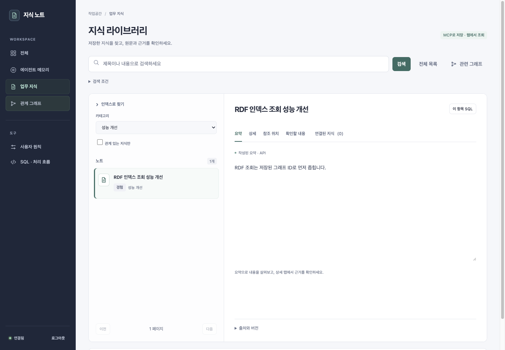

# Hotfix · RDF 인덱스 조회와 웹 화면 (2026-11-22)

RDF 인덱스 조회가 지연돼 Claude 메모리 훅의 45초 제한을 초과하던 문제를 수정하고, 지식 웹 화면의 반복 HTML 요소와 CSS를 공통화했습니다. 알파 버전 위의 hotfix이며 별도 정식 릴리스 보장을 의미하지 않습니다.

## RDF를 ID로 좁히지 않고 이름으로 비교하던 문제

기존 VK_NAV 조회는 저장된 그래프 ID로 먼저 필터링하지 않았습니다. RDF 행마다 `GET_MODEL`로 그래프 이름을 변환해 비교했고, 인덱스 항목마다 이를 반복했습니다. KEV 자동 탐색은 선택한 인덱스도 읽으므로 지연이 KEV 때문인 것처럼 보였으나, 분리 측정한 KEV 판단은 약 0.165초였습니다.

이미 VK_SHARED에서 사용하던 `G_ID` 조회를 공통 SQL 생성 함수로 추출해 VK_NAV에도 적용했습니다. 정확한 소유자·버전 그래프 URI를 바인딩하고, 저장된 ID로 좁힌 다음 트리플을 변환합니다. 전체 트리플 일치·누락·예상 밖 결과·초과 행 검증은 유지합니다. DB 스키마와 HTTP/MCP 데이터 계약은 바꾸지 않았습니다.

| 동일 요청의 측정 구간 | 수정 전 | 수정 후 |
|---|---:|---:|
| KEV 경로 판단 | 0.165초 | 0.165초 |
| 첫 인덱스 8개 항목 | 22.339초 | 0.195초 |
| 둘째 인덱스 8개 항목 | 22.538초 | 0.099초 |
| KEV 자동 모드의 훅 전체 | 45초 제한으로 차단 | 3.68초 완료 |

이는 특정 운영 환경·요청에서의 관측값입니다. 재시작 직후 첫 전체 요청은 18.71초였으며, 모든 검색의 처리 시간이나 정확도를 보장하지 않습니다. 초기의 “KEV 분류기가 느리다”는 진단을 정정했습니다. 임시 직접 검색 우회는 해제했고 KEV 자동 모드를 유지합니다.

## 웹 화면과 공통 요소

- 왼쪽 저장소 탐색, 검색 도구 모음, 선택 목록과 상세를 분리했습니다.
- 모바일은 목록에서 선택하면 상세로 들어가고, 목록 복귀 시 선택한 행으로 포커스가 돌아옵니다. 로그아웃도 유지합니다.
- 사용자 원칙은 네이티브 dialog에서 열며 Escape로 닫고 호출 버튼으로 포커스를 돌려줍니다. 기존 승인 저장 동작을 유지합니다.
- Foundation에 버튼·입력·배지·목록 행·빈 상태·제목·모달의 CSS 클래스와 안전한 DOM 생성 함수를 추가했습니다. `ui-page-header`, `ui-empty-state`, `ui-badge`는 light DOM 요소입니다.
- 외부 UI 프레임워크·CDN·폰트 의존성은 추가하지 않았습니다. 기존 134개 DOM ID, 인증·CSRF·CSP 경계와 원문·근거 조회 기능을 유지합니다.
- SQL 안내도 행별 이름 비교 대신 `G_ID` 선필터 예제로 갱신했습니다.

[공통 요소 사용법](../../packages/python-foundation/docs/ui-elements.md) · 실행 중인 앱의 `/knowledge/components`에서 구성 요소를 확인할 수 있습니다.

### 화면 예시

다음 이미지는 합성 데이터를 넣은 로컬 미리보기입니다. 실제 사용자 기록이 아닙니다.

[390px 모바일 화면](../images/knowledge-ui-mobile.png)

## 검증과 한계

- Ruff 검사·형식 검사·mypy 통과, 전체 pytest 347개 통과.
- Foundation wheel 빌드 및 소스 경로가 없는 격리 환경 설치 검증 통과. 새 UI 자산 포함 여부와 기존 6가지 생성 앱 조합을 확인했습니다. Oracle 템플릿 조합의 이 검증 실행은 SQLite 런타임이므로 실제 Oracle 접속 검증과 구분합니다.
- Orca 브라우저에서 1440px/390px, 카테고리, 페이지 이동, 노트 상세, 모바일 목록 복귀·포커스, 원칙 모달·Escape·포커스 복귀, 빈 결과·조건 초기화, 그래프 화면 전환, 중복 ID·가로 넘침·텍스트 HTML 비실행을 확인했습니다.
- 로컬 목록·검색·원문은 합성 데이터의 실제 앱 API로 확인했습니다. 로컬 미리보기의 그래프·확인 질문은 비어 있는 합성 응답이며 운영 그래프 전체의 품질 검증이 아닙니다.
- 운영 웹에도 반영한 뒤 공개 페이지에서 Foundation 요소 로딩, 새 탐색·로그인 화면, 가로 넘침 없음과 브라우저 콘솔 오류 없음을 확인했습니다. 운영 사용자로 로그인해 전체 데이터를 순회한 검증은 아닙니다.
- RDF 성능 수치는 실제 Oracle API 측정입니다. 웹 원칙의 실제 사용자 데이터 변경은 시험하지 않았습니다.

## 참고한 공식 디자인 자료

- [IBM Carbon · Data table](https://www.carbondesignsystem.com/building-blocks/core/components/data-table/guidelines): 검색·필터 도구 모음과 행의 선택 상태.
- [Adobe Spectrum · App frame](https://spectrum.adobe.com/foundations/app-frame/overview): 탐색·전체 동작·선택 항목 동작의 영역 분리.
- [Atlassian · Empty state](https://atlassian.design/components/empty-state/): 빈 이유와 다음 동작을 짧게 안내.

자료 확인일 2026-11-22. 공식 패턴을 참고해 구현했으며 외부 소스와 브랜드 에셋을 복제하지 않았습니다.
